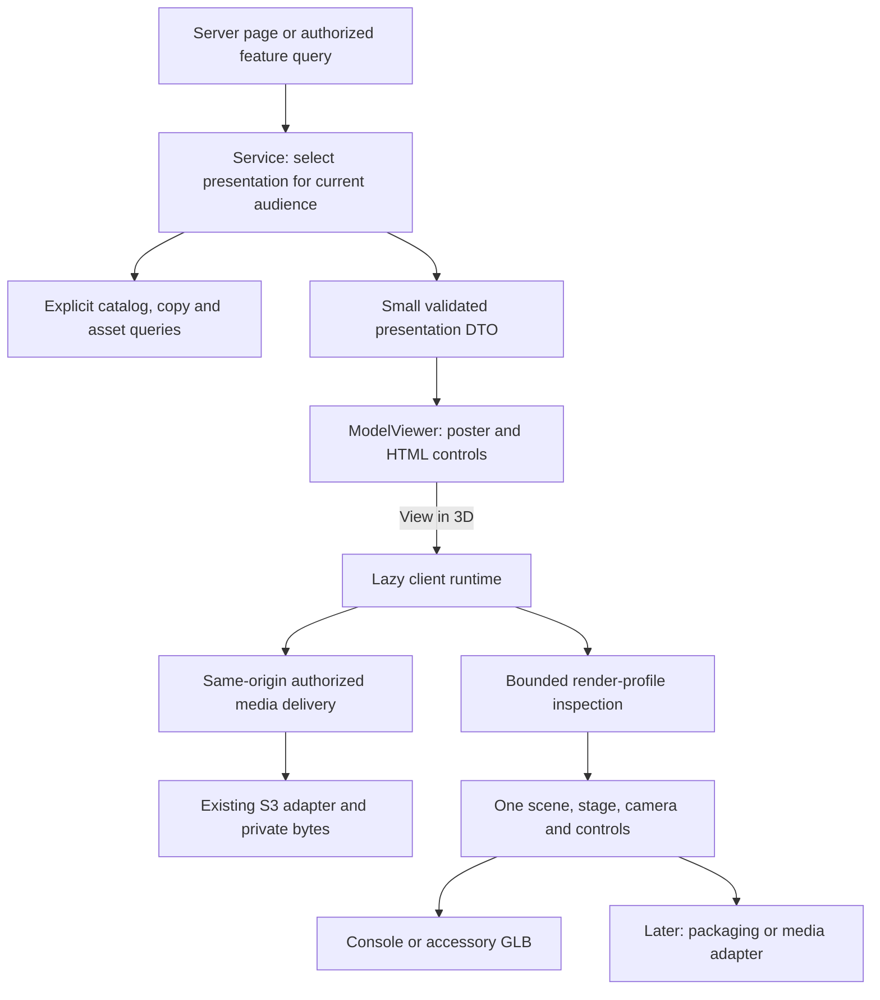

# GemuKore — 3D Architecture

Task: **9.1 — 3D Architecture**  
Date: **2026-10-15**  
Status: **Design complete.** Implementation follow-up: Task 9.2 adds the private viewer described in [ModelViewer operations](../operations/MODEL_VIEWER.md); Task 9.3 records [automated performance evidence](../performance/3D_PERFORMANCE.md) and retains the pending physical-device calibration. The evidence and design-task scope below record the state inspected on 2026-10-15.

## 1. Decision and scope

Use one reusable, optional `<ModelViewer />` built with Three.js, React Three Fiber (R3F) and selected Drei helpers. The server chooses an authorized presentation; a small client shell shows its static poster and loads the rendering runtime only after **View in 3D**. The viewer handles the stage, camera, controls, loading and cleanup. Content adapters supply console/accessory GLBs or, later, packaging/media geometry with explicit artwork bindings.

Keep one active Canvas per page, including fullscreen/dialog mode. Collection grids stay static. Start with session-owned resources, explicit disposal and no persistent model cache. This is a small feature inside the existing Next.js application, with no new service, queue, scene editor, plugin registry or general game engine.

This document implements the design deliverable only: no components, dependencies, schema, migrations, assets or public endpoints are added. It develops [specification §§16–18, 41–45 and 117–124](../../PROJECT_SPEC.md), [the accepted domain model §§6–7](DOMAIN_MODEL.md), [repository boundaries](REPOSITORY_ARCHITECTURE.md), [storage architecture](STORAGE_ARCHITECTURE.md) and [DESIGN.md](../../DESIGN.md). Task 14.1 still finalizes template persistence and authoring mechanics; Phase 18 still implements public publication/delivery. The Task 8.5 detail page remains unchanged.

## 2. What exists and what is missing

| Existing evidence                                                                                                                                                                                                             | Consequence for this design                                                                                                                                                                                             |
| ----------------------------------------------------------------------------------------------------------------------------------------------------------------------------------------------------------------------------- | ----------------------------------------------------------------------------------------------------------------------------------------------------------------------------------------------------------------------- |
| `src/server/assets/processing.ts` accepts self-contained binary glTF 2, preserves original bytes, rejects every JSON `uri` and all required extensions, bounds structure and validates embedded PNG/JPEG plus glTF semantics. | Reuse ingestion. Do not enable remote resources, GLTF packages, converters or decoder downloads through the viewer. Optional extension support still needs a viewer allowlist.                                          |
| Current upload ceilings: GLB 50 MiB; JSON 1 MiB; depth 32; 100,000 traversed values; arrays 4,096; aggregate accessor counts 1 million; embedded images 32 and aggregate pixels 64 million.                                   | These are storage/validation ceilings, **not** a mobile rendering guarantee. Interactive admission is narrower (§9). Existing files outside that profile remain privately downloadable.                                 |
| `src/server/http/assets.ts` and `/api/media/private/[id]` authorize current session/grant, require READY bytes, stream GET/HEAD and single ranges, use private/no-store headers and avoid exposing storage locators.          | Fetch through this same-origin application endpoint. Its attachment disposition for ORIGINAL files does not prevent an authenticated JavaScript fetch. No S3 URLs, read tokens or signed URL infrastructure are needed. |
| GLB upload currently produces only an ORIGINAL asset. Image uploads produce separate display/thumbnail derivatives. Asset metadata contains a strict versioned upload manifest.                                               | Private viewing may use the authorized GLB original. It is **not** eligible for public delivery. Do not call it a public display derivative or insert unvalidated viewer settings into the upload manifest.             |
| Task 8.5 resolves copy custom model → model default → platform default and labels the source, but returns only a URL/source for download.                                                                                     | Reuse the relationship precedence, not that minimal object as a sufficient viewer contract. A later authorized presentation query supplies bounded resource and presentation data.                                      |
| `package.json` has React 19.3 and no Three.js, R3F or Drei. No template/component-presence tables or renderers exist in `prisma/schema.prisma`.                                                                               | Add/pin compatible dependencies in 9.2; introduce the already-designed template/component relations in Phase 14. No duplicate default-model FKs or early template tables.                                               |

References to repository paths above describe the inspected implementation at Task 9.1, not functionality introduced by this document. The [asset operations guide](../operations/ASSET_UPLOADS.md) records the existing validation and lifecycle boundaries.

## 3. Layers and ownership

| Module boundary                   | Responsibility                                                                                                                             | Must not do                                                                                   |
| --------------------------------- | ------------------------------------------------------------------------------------------------------------------------------------------ | --------------------------------------------------------------------------------------------- |
| Feature server entry/query        | Obtain identity/context and call the relevant service.                                                                                     | Read Prisma directly or embed viewer business rules in a page.                                |
| Collection/catalog/public service | Select the owned/canonical relationship, source label, poster, preset and authorized asset uses. Validate IDs and current audience policy. | Import React/Three.js, trust a submitted URL, or send a private entity to a public component. |
| Repositories and delivery         | Explicit selects; current authorization and asset lifecycle checks before streaming.                                                       | Treat a descriptor, hash or known Asset ID as permission.                                     |
| `components/three`                | Reusable viewer shell and browser-only runtime. Accept presentation data, never catalog entities.                                          | Query the database, select product identity, publish assets or know S3 credentials.           |
| `lib/three`                       | Dependency-light DTO/schema, numeric validation, profile inspection and camera/texture calculations.                                       | Import server modules; eagerly import Three.js into contracts or static pages.                |
| Future physical-edition feature   | Assemble one selected release component's template and artwork description.                                                                | Create a second Canvas, controls implementation or universal template entity.                 |

Follow the already-planned `src/components/three/` and `src/lib/three/` layout. In 9.2, create only the files needed for the viewer shell, runtime, GLB loading/cleanup, stage/controls and neutral contracts/helpers. Keep source selection in the existing collection service layer; factor a shared resolver only when there is actual reuse. Packaging/media adapter files arrive in their own tasks. No runtime barrel may pull the heavy renderer into an otherwise static card or server query.

### Presentation contract

Use a strict, serializable, version-1 discriminated description. This is a proposed contract, not an application type added by Task 9.1.

| Part                  | Minimum data / rule                                                                                                                                                                                                                                                                       |
| --------------------- | ----------------------------------------------------------------------------------------------------------------------------------------------------------------------------------------------------------------------------------------------------------------------------------------- |
| Presentation          | `schemaVersion`, opaque `presentationKey`, accessible title, source label, content description and optional approved/static poster. A null content source produces only a static fallback.                                                                                                |
| Resource              | Immutable asset reference, same-origin delivery URL, verified MIME and byte length. Private URLs use the existing route; future public URLs identify the permitted item/use/component context. No bucket/key, arbitrary URL, credentials, original filename, audit actor or raw metadata. |
| Content               | Initially `kind: GLB` and one model resource. Later explicit `PACKAGING` / `PHYSICAL_MEDIA` descriptions contain one template revision, procedural dimensions or one GLB resource, and bounded slot bindings. No arbitrary React children, executable shaders or scene JSON.              |
| Presentation settings | Named camera/lighting profile plus validated orientation, positive uniform scale and optional bounded camera overrides. Initially use code defaults: no new per-copy settings editor or metadata column.                                                                                  |
| Identity              | Key changes when selected use/asset, item revision, template revision, artwork/transform or viewer contract changes. It is a remount/staleness identity, never authorization or a globally reusable cache key.                                                                            |

Validate server-produced settings as well as incoming mutations. A malformed optional presentation setting uses a safe default; invalid content/resources produce fallback. Do not pass unknown metadata through to a Three.js constructor. Feature-specific DTOs can wrap this shared contract without putting feature imports into shared components.

### Selection and fallbacks

Private presentation reads require current `private.read`, including VIEWER accounts; loading a model never requires collection-edit permission. Private console precedence is the existing primary custom use → primary model MODEL_3D use → primary platform MODEL_3D use → no model. Accessory precedence later is copy → variant → family. Canonical and owned records remain separate; selecting a preview never writes a catalog or copy override.

Only READY, appropriately typed resources qualify. Label inheritance. For a deliberately selected custom model that fails loading or interactive admission, keep its source choice and show a static fallback with the existing private download action. Do not silently replace it with another object's geometry. The same principle applies to a failed selected catalog resource; a retry/reselection comes from a fresh server query.

A poster is independently selected: an appropriate private DISPLAY photo, model preview/cover, platform preview, then a neutral placeholder. Avoid selecting SERIAL media as an automatic hero. A logo can remain beside the object identity but does not stand in for a rendered-model thumbnail. Public poster selection must run the public policy independently. No generated thumbnail is promised in 9.2; existing images are sufficient.

## 4. Loading and viewer lifecycle

1. Render useful item information and a stable-aspect poster on the server. The lightweight shell can hydrate without loading Three.js, GLB bytes, textures or a WebGL context. No JavaScript/WebGL still leaves a complete page.
2. **View in 3D** obtains/revalidates the presentation through a private feature query/action when needed. A stale item/use selection prompts a refresh; authorization failures stop here. This is a read, not a new upload or publication endpoint.
3. Import the browser runtime. Keep `next/dynamic` with `ssr: false` inside a Client Component; the outer page remains a Server Component. Next.js documents this client boundary requirement in its [lazy-loading guide](https://nextjs.org/docs/app/guides/lazy-loading).
4. Fetch selected resources with same-origin credentials, `cache: no-store`, an AbortController, bounded actual streamed bytes and an explicit deadline. Validate response status/type/length; reject unexpected redirects. A descriptor's advertised size is an early check, not the final byte limit. Do not prefetch a model when a card enters the viewport.
5. Before loader parsing or image decoding, inspect the bounded GLB JSON/BIN and embedded image headers against §9. Resource-URI refusal is repeated defensively; inspection is technical admission, not a replacement for server content/security validation. Missing/invalid information means fallback, not “assume small.”
6. Use a session-local `GLTFLoader` on the fetched ArrayBuffer. Do not configure Draco, Meshopt, KTX2 or network decoder paths. Load the selected/default scene only; do not autoplay clips or adopt authored cameras/lights. Check the parsed scene's finite, nonempty bounds and actual resource counts before attaching it to Canvas. Client bounds/resources are rechecked after parse; unsupported devices or failed context creation use fallback.
7. Fit and render the scene, then expose controls. An error boundary encloses the runtime; its loading and failure states retain the poster, description and explicit retry/close controls. Track a session generation so a late fetch/parser callback cannot replace a newer selection or attach to an unmounted viewer.
8. Switching item/component, closing, entering a replacement dialog viewer, route departure or sign-out ends that session: abort transfers, discard/dispose late parse results and release scene resources. Background/offscreen viewers pause frames and rotation; interrupted loads show an explicit resume/retry rather than an endless spinner.

State model: **static → loading runtime → fetching → inspecting/decoding → ready ↔ paused → closed**, with **fallback** reachable from every loading/render state. A missing source has no misleading 3D activation button. Progress uses received bytes only when the total is known; parsing/compilation use labeled indeterminate states, not invented percentages. A “100% downloaded” model is not yet ready to display.

Use an initial 60-second fetch deadline and a 10-second decode/first-frame watchdog as tunable UX limits. A watchdog cannot preempt synchronous JavaScript or undo a download; mark the session obsolete and dispose any late result. Hard admission limits do the work of bounding allocation. Add workers only if measured loading still blocks interaction after asset simplification.

## 5. Cache, scene identity and cleanup

**Initial choice: no cross-session GLB/texture cache.** Use an explicit fetch/parse lifecycle rather than `useGLTF`/`useLoader` as a global private-file store. This avoids both ambiguous disposal ownership and cached bytes being reused without a new permission check. Resources may be reused _within_ the active session for camera reset and native fullscreen. Do not enable `THREE.Cache`, model preloading, service-worker storage, localStorage or IndexedDB for private resources.

R3F documents URL-based reuse in `useLoader`; it also warns that an Object3D cannot occupy two scene positions and that `primitive` objects require explicit disposal. Those behaviors are reasons for this ownership choice, not reasons to forbid future measured reuse. [R3F performance](https://r3f.docs.pmnd.rs/advanced/scaling-performance), [R3F object lifecycle](https://r3f.docs.pmnd.rs/api/objects).

| Resource                                                                   | Owner and release rule                                                                                                                                                                                               |
| -------------------------------------------------------------------------- | -------------------------------------------------------------------------------------------------------------------------------------------------------------------------------------------------------------------- |
| Parsed GLB scene                                                           | One load session. Traverse all parsed scenes/dependencies, including resources outside the selected visible scene, with visited sets so shared objects are released once. Do not mutate or mount a cached scene.     |
| Geometry, materials, maps, procedural meshes                               | Session-owned. Dispose geometry/material and each distinct texture separately; replacing one template material must not affect another mesh sharing the old material.                                                |
| ImageBitmaps / loader blob URLs                                            | Close owned bitmaps and revoke owned object URLs after no texture references them; cover late callbacks and failed parses. Check pinned loader behavior so application and loader do not compete over URL ownership. |
| Controls, generated environment/PMREM, render targets, listeners/observers | Viewer-owned; disconnect/dispose on teardown. Ordinary frame/camera changes do not recreate these resources.                                                                                                         |
| Canvas/renderer                                                            | R3F owns its renderer lifecycle. Let the Canvas teardown handle it; resource cleanup must not create a second renderer or double-dispose an active one.                                                              |

Three.js requires explicit cleanup for these GPU resources; disposing a material does not dispose its textures, and ImageBitmap CPU memory needs separate handling. Use ownership/visited sets rather than a scene-wide `dispose={null}` with no cleanup. Monitor stable resource counts after repeated opens, not an unrealistic expectation that every internal counter becomes zero. [Three.js disposal guidance](https://threejs.org/manual/pages/how-to-dispose-of-objects.html).

If a later feature proves that sharing is necessary, require scoped cache identity, current authorization before reuse, bounded eviction and reference-counted ownership before enabling it. Private and public lifetimes must stay distinct. Already delivered bytes cannot be recalled; no-store and cleanup prevent unintended reuse rather than promising revocation of downloads or screenshots.

## 6. Coordinates, camera, lighting and controls

### Geometry and camera

- Follow glTF's right-handed coordinate system; template authoring convention is +Y up and front artwork facing +Z. Use meters in the rendering scene; template dimensions are stored in millimeters and converted once (`mm / 1000`). Confirm these conventions with an asymmetric labeled reference fixture. [glTF coordinate/unit specification](https://registry.khronos.org/glTF/specs/2.0/glTF-2.0.html#coordinate-system-and-units).
- Preserve source geometry. Put imported content under a presentation group: apply the validated orientation/uniform scale, measure its world bounds, center it and uniformly normalize its longest side to two viewer units. Never use normalization to infer or overwrite physical measurements or scale different axes independently.
- Use one perspective camera, initially 35° vertical field of view, targeting the normalized center from a front three-quarter direction. Fit from finite bounds and actual aspect ratio with a 20% margin; derive near/far and zoom limits from those bounds. A tall phone viewport must fit the object just as reliably as a wide desktop stage.
- Start with `console` and generic `object` camera presets. Phase 14 adds `package` and `cartridge` presets, with front/back views for reading artwork. Presets are small validated data, not separate viewer components. Keep orientation, projection and template settings explicitly versioned; avoid renderer magic based on a product name.
- Camera overrides, when introduced, accept finite radians/positive scales and bounded FOV (20°–70°), normalized target offsets and distance factors. Reject NaN, infinity, zero/negative scale and unbounded transforms. Template contract/UV changes require a new revision; camera-only adjustments may remain mutable under the domain contract.
- Reset restores the fitted preset and control target. Fit once after a source/orientation change; after resize/fullscreen preserve user direction while updating fit/clipping as necessary. Do not reset the user's orbit on every render or theme change. Drei's [Bounds helper](https://drei.docs.pmnd.rs/staging/bounds) can provide fitting/clipping; validate its behavior against the pinned version and reset contract.

### Lighting and appearance

Use a restrained neutral studio stage: modest key/fill lights and a generated room environment for PBR reflections. Three.js provides [RoomEnvironment](https://threejs.org/docs/pages/RoomEnvironment.html); generating its environment locally avoids remote HDR presets and another asset download. Bound and dispose the environment map/PMREM with the viewer. Keep the same neutral illumination in both themes, with the warm `stone` background supplied by application tokens.

Respect authored PBR materials. Initial quality has no real-time shadows, contact shadows, postprocessing, bloom, particles, model animation or automatic intro camera travel. No custom shader/plugin supplied by asset metadata. This preserves the design system's quiet object-focused presentation and leaves a lower-cost lighting fallback if environment generation fails.

Use a linear lighting workflow and sRGB display output. Color/albedo artwork is sRGB; roughness/normal/metalness data is non-color. Keep GLTFLoader's authored map configuration; explicitly configure only newly bound external artwork. [Three.js color-management guidance](https://threejs.org/manual/pages/color-management.html).

### Interaction and accessibility

Drei OrbitControls can supply pointer/touch orbit and zoom with demand-render invalidation. Start with panning disabled, bounded distances and optional damping; disable damping under reduced motion. Controls must converge to no frames when idle. [Drei controls](https://drei.docs.pmnd.rs/controls/introduction).

Provide labeled HTML rotate-left/right/up/down, zoom-in/out, reset, auto-rotate and close controls, with visible focus and 44px targets. Gestures are an enhancement. Keyboard shortcuts operate only while the viewer is focused; do not intercept page scrolling or form shortcuts elsewhere. Include an accessible model description and instructions outside Canvas; no required catalog/copy fact exists only inside 3D.

Auto-rotate starts **off**, is an explicit session choice and stops while hidden/offscreen. A live reduced-motion preference disables it and camera tweening, including an already-running rotation; never silently restart it when the preference changes back. Manual rotation/zoom/reset remain available. Touch interaction starts only after activation; keep page scrolling possible outside the stage and leave Close reachable at 320px.

Prefer the native Fullscreen API following a user gesture, preserving the same Canvas. If unsupported/denied, use the existing accessible dialog primitives for an expanded view. Unmount the inline session before mounting the dialog session, preserve only a small validated camera pose if useful, and reauthorize/refetch as needed. There is never an inline and dialog Canvas simultaneously. Escape/cancel restores trigger focus; context loss or fullscreen failure retains a usable static/inline alternative.

## 7. Packaging, physical media and textures — extension contract

Keep **PackagingTemplate** and **PhysicalMediaTemplate** separate, as already accepted in [DOMAIN_MODEL.md §7](DOMAIN_MODEL.md). They share stage/helpers, not a new universal template table. Packaging can be a dimensioned procedural box or a GLB; physical media initially uses an authored GLB for CARTRIDGE/DISC/CARD/OTHER. Start with a few actual collection formats in Phase 14.

A flat `GameReleaseIncludedItem` of the right kind selects one template revision. Its explicit PackagingTextureBinding or PhysicalMediaTextureBinding chooses an IMAGE asset for one slot belonging to that exact template. At most one binding exists per component/slot. Do not put competing template FKs on GameRelease, infer templates from platform names or turn one cover image into a complete box wrap.

| Concern                    | Required contract for Phase 14                                                                                                                                                                                                                                                                                                           |
| -------------------------- | ---------------------------------------------------------------------------------------------------------------------------------------------------------------------------------------------------------------------------------------------------------------------------------------------------------------------------------------- |
| Template readiness/version | A READY template has valid positive dimensions, appropriate geometry and a resolvable material/UV slot contract. Once referenced, geometry/material-name/UV changes create another template row/revision and explicit reassignment. No silent breakage of existing releases.                                                             |
| Slot target                | Stable semantic slot key (FRONT, SPINE, FRONT_LABEL, DISC_ART, etc.) maps to a verified mesh/node plus named material/material index or procedural face. Names are template-local; ambiguous/missing targets fail readiness. A material name alone is insufficient if it occurs on several unrelated meshes.                             |
| Artwork                    | Explicit component/slot/asset binding. Use sanitized DISPLAY images, not raw originals or automatically selected personal photos. No copy-level game-texture override system is introduced here.                                                                                                                                         |
| Mapping                    | Define UV channel, upright orientation, expected aspect and an optional normalized crop/UV transform. Default to contain with a neutral unused surface; stretch, mirror and destructive crop are not implicit. Reject transforms outside their validated bounds.                                                                         |
| Mutation isolation         | Create an instance-owned material/texture configuration before applying a binding, including when a GLB reuses a material across meshes. Keep authored non-artwork materials intact. Never alter a different release's cached/shared scene.                                                                                              |
| Texture semantics          | Replacement color maps use sRGB and the template's glTF UV orientation; `TextureLoader` replacements generally require `flipY=false`. ImageBitmap orientation must be handled at decode, because Texture.flipY does not affect it. Verify with labeled asymmetric art. [Texture reference](https://threejs.org/docs/pages/Texture.html). |
| Missing artwork            | A private geometry preview can show neutral missing faces with **Artwork incomplete**. Missing required artwork blocks a complete/public presentation; optional missing faces stay neutral. Required means render completeness, not permission to save a catalog release. Never generate or guess missing art silently.                  |
| Multiple pieces            | Outer box, inner case, Disc 1 and Disc 2 are distinct flat components with their own artwork where needed. Render the selected piece in the same viewer. Quantity represents interchangeable pieces; no nested scene/container hierarchy or simultaneous shelf simulation.                                                               |
| Owned presence             | Expected release contents and actual owned presence stay separate. Confirmed absent parts are not shown as present; unknown presence is labeled. A catalog package preview never implies the owner has its box. Preserve the accepted primary-package/hasBox reconciliation for Phase 14.                                                |

The procedural-box renderer defines an explicit six-face/material mapping; the cartridge renderer supplies different geometry with the same loading/camera/controls lifecycle. A renderer switch on the small content-kind union is sufficient. No renderer registry or per-product custom mesh generation.

## 8. Public/private delivery and provenance

**9.2 starts private.** A successful upload, known URL, `publicSafe` flag or catalog source label does not enable publication. ORIGINAL GLBs stay private. Public 3D later needs an explicit reviewed DISPLAY model derivative; its embedded images must be reviewed as part of those bytes, and input rights must be approved. Sanitizing metadata alone cannot remove a serial printed into an embedded texture.

Phase 18 must construct a dedicated public presentation DTO and recheck global enablement, item publication, relevant visibility settings, approved use/component presentation, READY DISPLAY bytes, rights/content review and applicable lineage for every request, including HEAD/ranges. Personal custom logos/models obey the personal-media gate. If a private override is ineligible, choose an independently approved canonical fallback and label its source; never send the private descriptor to the browser to filter it there.

For templated viewers, every delivered base geometry and separate texture must qualify, including the embedded textures inside a base GLB. A texture is not publicly eligible because its geometry is. Use context-scoped public delivery so an Asset ID cannot bypass the permitted item/use/component. Retain no-store/current-policy checks; no signed reads, shared CDN responses, loader cache or image optimizer can bypass revocation. A failed public asset request shows an approved poster/placeholder, never a private route fallback.

Future generated model/package thumbnails are Asset derivatives with fixed RENDER_INPUT dependencies on all contributing geometry/artwork plus versioned renderer/settings provenance. They need their own content approval and input-rights checks. Source originals need not become public-safe merely to allow an independently sanitized/reviewed output. Generation is explicit later work; it does not justify a worker service or automatic public thumbnail pipeline now.

## 9. Mobile and performance profile

Use a conservative **interactive-v1** admission profile, initially common to phones and desktop. These are proposed engineering limits, **not measured performance claims** or changes to upload acceptance. An over-budget file remains stored and privately downloadable, while the viewer shows a clear static alternative. Do not alter bytes, silently downsample/re-export the original, or loosen a limit based solely on desktop hardware.

| Dimension            | Initial viewer decision                                                                                                                                                                                                                                                          | Where enforced / measured                                                                                                                                                                                                                                                                                                 |
| -------------------- | -------------------------------------------------------------------------------------------------------------------------------------------------------------------------------------------------------------------------------------------------------------------------------- | ------------------------------------------------------------------------------------------------------------------------------------------------------------------------------------------------------------------------------------------------------------------------------------------------------------------------- |
| Active contexts      | At most one live viewer; no Canvas in any collection card.                                                                                                                                                                                                                       | Page/controller composition; browser tests and context count.                                                                                                                                                                                                                                                             |
| Transfer             | One GLB ≤8 MiB; future assembled view ≤12 MiB including separately bound textures.                                                                                                                                                                                               | Verified descriptor early check and actual streamed-byte cap before parsing; total across selected component.                                                                                                                                                                                                             |
| Supported content    | Static glTF 2 triangle meshes, PNG/JPEG embedded images, core PBR and tested optional KHR_materials_unlit only; no required extensions. No skins, morph targets, animations, lines/points or extra loader plugins in v1.                                                         | Inspect full document before loader decode. Other accepted uploads get an unsupported-preview fallback; ingestion is not retroactively changed.                                                                                                                                                                           |
| Complexity           | ≤200,000 rendered triangles counting repeated node instances; ≤80 estimated draw calls (including material groups and extra transparency passes); ≤256 selected-scene nodes and ≤64 materials. All-scene allocations also remain bounded, or reject extra nonempty scenes in v1. | Bound full JSON and selected graph before parse, then check actual instantiated resources. A unique mesh count is not enough; verify actual renderer draw counts once ready.                                                                                                                                              |
| Texture/GPU estimate | ≤8 decoded artwork/model textures, longest edge ≤2,048, aggregate ≤8 million pixels; estimated total texture allocation including mips/environment ≤64 MiB.                                                                                                                      | Inspect embedded PNG/JPEG headers before decode; later bindings supply verified dimensions and are rechecked. Count distinct texture configurations, not only unique source image IDs. RGBA8+mips estimate is approximately width × height ×4×4/3, not compressed file size. Driver/render-target overhead is additional. |
| Geometry             | Estimated attribute/index allocation ≤24 MiB across parsed resources. Reject nonfinite/empty bounds.                                                                                                                                                                             | Inspect buffer/accessor relationships, avoid double-counting shared buffers, verify actual parsed arrays before GPU upload.                                                                                                                                                                                               |
| Resolution           | Default DPR 1; optional measured desktop quality up to 1.5, never device DPR without a cap. Limit the drawing buffer to 2 million pixels and hardware limits, including fullscreen.                                                                                              | Runtime viewport/aspect/DPR calculation. Reduce resolution rather than crop/stretch the object.                                                                                                                                                                                                                           |
| Frame work           | Demand rendering when static; continuous frames only for active control damping or explicit allowed rotation. Zero scheduled scene frames while hidden/offscreen. No real-time shadows/postprocessing in v1.                                                                     | Invalidations and visibility observers; trace controls settling and live motion-preference changes.                                                                                                                                                                                                                       |
| Load work            | Fetch sequentially/bounded; decode one selected component; no speculative model/texture preloading.                                                                                                                                                                              | Session lifecycle, byte/time limits and network assertions.                                                                                                                                                                                                                                                               |

The preflight must check these bounds **before** GLTFLoader image decoding/GPU attachment, including image headers; checking only after a huge texture has decoded is too late. Abort/cancel obsolete requests and dispose stale results. GPU maximum texture size/context support can further lower admission. Current Three.js WebGLRenderer requires WebGL2; unsupported or failed contexts receive static fallback rather than a WebGPU/WebGL1 parallel stack. [Renderer requirements](https://threejs.org/docs/pages/WebGLRenderer).

Task 9.3 validates and adjusts the profile using representative plain GLBs, shiny/translucent hardware and texture-heavy cases on a physical iOS Safari phone and a physical Android Chrome phone, recording device/OS/browser, asset counts, transfer/first-frame time, interaction frame times and repeated-open memory trends. Target at least 30 fps during interaction and no continuing idle/offscreen rendering; these are acceptance goals to measure, not achieved results. Software-rendered Playwright verifies behavior, not phone GPU performance.

The original review asked for phone-based budget selection in 9.1. No physical-device benchmark or renderable fixture library exists in the current repository, and no renderer is implemented in this task. This design therefore makes the initial numeric choices explicit and provisional; real-device calibration is a required 9.3 handoff before claiming mobile performance is complete. Missing hardware evidence must be reported, not replaced by desktop timings. Avoid a device database or adaptive-quality framework until those measurements justify one; DPR reduction/static fallback are the first responses.

## 10. Implementation sequence and acceptance

| Task                             | Implement when authorized                                                                                                                                                                                                                                                                                                                                                | Completion evidence                                                                                                                                                                                                                                  |
| -------------------------------- | ------------------------------------------------------------------------------------------------------------------------------------------------------------------------------------------------------------------------------------------------------------------------------------------------------------------------------------------------------------------------ | ---------------------------------------------------------------------------------------------------------------------------------------------------------------------------------------------------------------------------------------------------- |
| **9.1 — this document**          | Architecture, source review, implementation boundaries and initial budgets.                                                                                                                                                                                                                                                                                              | Consistency with accepted domain/storage/UI rules, current implementation, official API guidance, local links, formatting and whitespace checks. No runtime benchmark claim.                                                                         |
| **9.2 — ModelViewer**            | Pin compatible Three/R3F/Drei versions; private presentation/query adapter; static shell and client runtime; GLB preflight; stage/camera/lighting; orbit/zoom/touch, reset, fullscreen, optional rotation, reduced motion, cancellation, fallback and owned-resource cleanup. Include baseline lazy import and demand rendering because they are correctness boundaries. | Meaningful unit/component, PostgreSQL authorization/selection and production desktop/mobile browser checks. Real model interaction/download and fallback, not just a mocked Canvas. No template schema, public delivery or Phase 10 detail redesign. |
| **9.3 — 3D Performance**         | Measure/enforce the loading/bundle/resource budgets; strengthen visibility/cleanup and loading states; calibrate quality on physical phones. Grids retain existing static images.                                                                                                                                                                                        | Network/chunk traces, no pre-activation 3D bytes/context, stable repeated-open resources, low-resolution/hidden behavior and recorded phone results. Thumbnail generation remains optional separate scoped work, not a new pipeline requirement.     |
| **10.1 — Console detail UX**     | Integrate the proven viewer into the existing console page's hero and refine identity/section presentation.                                                                                                                                                                                                                                                              | Preserve private copy fields, canonical provenance, existing CRUD, keyboard/mobile and fallback behavior. Do not rebuild CRUD.                                                                                                                       |
| **14.1–14.6 — Physical Game 3D** | Finalize existing component/template/binding domain; add procedural package and authored cartridge adapters, formats, texture preview and revision validation.                                                                                                                                                                                                           | Slot/material/UV and same-template invariants; two releases sharing geometry keep distinct artwork; multiple discs and missing/unknown presence remain truthful.                                                                                     |
| **18 — Public Museum**           | Dedicated public descriptors/delivery, approved DISPLAY derivatives and per-input publication checks.                                                                                                                                                                                                                                                                    | Direct model/texture/poster requests, HEAD/ranges and fresh activation after committed revocation all enforce current public gates; private descriptors never enter public HTML.                                                                     |

Before 9.2 dependency installation, verify the stable pinned versions against this project's React 19/Next.js/TypeScript. R3F currently documents Fiber 9 for React 19; choose a compatible Drei/Three combination and validate it in the production build rather than upgrading React to make a guessed dependency work. No exact future patch version is fixed by this design. [R3F installation compatibility](https://r3f.docs.pmnd.rs/getting-started/installation).

Required regression scenarios for implementation:

- Private source precedence, missing/archived targets, stale selection, viewer access and revoked/expired/demoted identity; canonical defaults never change during viewing.
- No Three/R3F/Drei chunks, GLB requests or Canvas before activation or in a grid; SSR/no-JavaScript poster remains useful.
- GLB/image/header/extension and budget boundaries, including repeated mesh instances, oversized texture dimensions, unknown/missing counts, invalid/empty bounds and network URI refusal. No external decoder/environment requests.
- Transfer failure, 401/403/404/503, timeout, unsupported GPU, context loss, blocked fullscreen, rapid item/component switches and unmount during parse; stale callbacks do not resurrect a scene.
- Keyboard/HTML controls and focus restoration, touch plus surrounding scroll, 320px/zoom, themes, resize and reduced motion enabled before and during an active session.
- Repeated open/reset/fullscreen/close, no duplicate Canvas, controls listeners disposed and stable resource trends. A close followed by reopen makes a fresh authorized request.
- Later: asymmetric face/label fixtures, material-sharing isolation, required/optional slot behavior, component/template mismatch, duplicate binding rejection, immutable referenced template revision and each public geometry/texture/derivative gate.

Keep benchmark fixtures small, synthetic or explicitly licensed and source-tracked. Do not download arbitrary console models into the repository to make the demo appear complete.

## 11. Deliberate simplifications and deferred decisions

Retain one perspective camera, one studio lighting profile, one low default quality level, one selected object/component and one small content-kind union. Use Drei where it saves work (controls/bounds), not as a reason to import its full preset/staging ecosystem. Session ownership removes the need for a shared GPU asset registry; static images remove the need for multiple grid contexts. Persist no camera state or private model blobs between sessions.

Deferred until there is a concrete need: Draco/Meshopt/KTX2 support, model conversion, animation/skeletons, dynamic LOD, WebGPU, mesh editing, custom shaders, multi-object arrangements, AR/VR, automated thumbnail jobs, render farms and CDN/signed-read delivery. These are extensions to an explicit input/profile contract, not toggles to enable accidentally in a loader.

No architectural question blocks the private GLB viewer handoff. The next task must choose/test exact dependency patches and implement the bounded loader/profile; 9.3 must supply real phone measurements; 14.1 finalizes schema/material authoring mechanics; public display preparation and rights/content review remain Phase 18 gates. The private viewer handoff requires no additional infrastructure.

## 12. References and review record

Primary implementation references were checked on **2026-10-15**. The linked upstream pages describe library behavior; repository-specific limits, ownership, filenames, security policy and task boundaries above are GemuKore design decisions. Exact APIs must be confirmed against the versions pinned during implementation.

- [R3F installation](https://r3f.docs.pmnd.rs/getting-started/installation), [Canvas](https://r3f.docs.pmnd.rs/api/canvas), [performance](https://r3f.docs.pmnd.rs/advanced/scaling-performance), [objects/disposal](https://r3f.docs.pmnd.rs/api/objects).
- [Drei controls](https://drei.docs.pmnd.rs/controls/introduction), [Bounds](https://drei.docs.pmnd.rs/staging/bounds), [useGLTF](https://drei.docs.pmnd.rs/loaders/gltf-use-gltf).
- [Three.js GLTFLoader](https://threejs.org/docs/pages/GLTFLoader), [RoomEnvironment](https://threejs.org/docs/pages/RoomEnvironment.html), [Texture](https://threejs.org/docs/pages/Texture.html), [color management](https://threejs.org/manual/pages/color-management.html), [cleanup](https://threejs.org/manual/pages/how-to-dispose-of-objects.html), [WebGLRenderer](https://threejs.org/docs/pages/WebGLRenderer).
- [Khronos glTF specification](https://registry.khronos.org/glTF/specs/2.0/glTF-2.0.html).
- [Next.js lazy loading](https://nextjs.org/docs/app/guides/lazy-loading).

Task 9.1 checks are documentation consistency, referenced-path/link validation, Markdown formatting and diff whitespace. Unit, database and browser suites are not applicable to these documentation-only edits and are not represented as rerun results. No dependency install, schema/data mutation, viewer implementation or physical-device performance test was performed.
