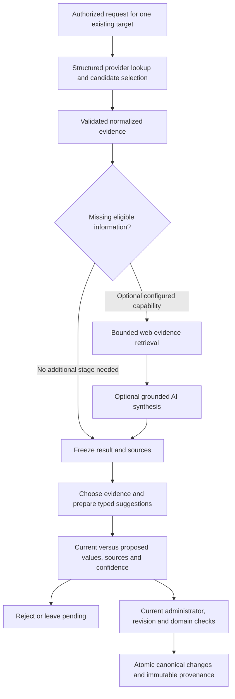

# GemuKore — Enrichment Architecture

Task: **13.1 — Enrichment Architecture**

Date: **2026-10-19**

Status: **Design complete.** This task adds documentation only. Service implementation, migrations, provider configuration and review UI belong to their assigned follow-up tasks.

## 1. Decision and boundaries

Enrichment is a private, bounded workflow that gathers evidence, proposes typed changes and lets an administrator accept an explicit reviewed selection. Retrieval never modifies canonical records. A completed retrieval, a high confidence score and an editor's proposal are all distinct from acceptance.



This develops specification §§32–37 and §§96–106, accepted decisions A10/C03/C07/C17 in the [architecture review](ARCHITECTURE_REVIEW.md), §8 of the [domain model](DOMAIN_MODEL.md), and the implemented [metadata-provider boundary](GAME_METADATA_PROVIDER_ARCHITECTURE.md). It preserves Game versus GameRelease and canonical versus owned-copy separation. The workflow starts with games; accessory adapters and UI arrive in their assigned phases.

Structured lookup works without AI or web credentials. Missing information is a valid outcome. Optional AI/web failure cannot prevent a useful structured result or a valid manual copy save. No model gets a database-writing tool, publication tool, arbitrary fetch capability or access to personal collection fields.

## 2. Repository evidence and implementation consequences

The following records the repository inspected for Task 13.1.

| Existing implementation                                                                                                                        | Design consequence                                                                                                                                                                             |
| ---------------------------------------------------------------------------------------------------------------------------------------------- | ---------------------------------------------------------------------------------------------------------------------------------------------------------------------------------------------- |
| Tasks 12.2/12.3 provide a server-only IGDB implementation, validated neutral DTOs and 222 provider regression cases.                           | Use `getGameMetadataProvider()` and neutral contracts. Enrichment services must not inspect IGDB response fields or duplicate its HTTP/token logic.                                            |
| Provider sections distinguish present/absent/unsupported/invalid/limited; each usable fact has evidence and explicit scope.                    | Preserve those distinctions through persistence and review. Missing, invalid or limited results never imply deletion.                                                                          |
| Current permissions grant `enrichment.suggest` to EDITOR/ADMIN and `enrichment.accept` plus `catalog.manage` to ADMIN.                         | Editors can retrieve and propose, while acceptance is administrator-only with current grant checks.                                                                                            |
| Catalog services use the shared catalog write guard, root revisions, active-relationship validation and transaction-bound repositories.        | Acceptance reuses these domain and concurrency rules. Never hold the catalog guard during external I/O.                                                                                        |
| `appendCatalogHistory` hardcodes MANUAL origin; current playtime/trailer editors use that helper.                                              | Imported acceptance needs a server-controlled provenance-aware mutation path, rather than calling a manual action and mislabeling history.                                                     |
| MetadataChange has explicit target FKs, typed before/after snapshots, origin and versioned sourceSnapshot. Run/suggestion tables are absent.   | Add the workflow tables and suggestion/change linkage in 13.2; accepted facts remain normal catalog columns/relations.                                                                         |
| Game and GameRelease have descriptions, relationships, references, sourced playtime and structured trailers. Sourced rating storage is absent. | Initial service eligibility uses implemented domain groups. Rating evidence remains reviewable but cannot be applied until the domain-model rating group has typed persistence and validation. |
| Private screenshot uploads validate bytes and use CatalogAsset; no provider image-ingestion service exists.                                    | Retain image candidates as evidence. Applying media requires a dedicated authorized ingestion path and valid target scope, not an external URL passed to the upload action.                    |
| Manual game creation selects existing canonical game/release records before saving copy-specific details.                                      | Enrichment targets an existing canonical root; never create an unbacked run for an unsaved UI draft or place private copy fields in the query.                                                 |

These are known implementation prerequisites, not a change to the product's conceptual model. Do not store unsupported accepted ratings or media bindings in generic `metadata` JSON to bypass them.

## 3. Layers and proposed files

Create files only as their implementation tasks require them:

```text
src/features/enrichment/
  contracts.ts          # serializable private review/result DTOs
  validation.ts         # strict action inputs and typed field choices
  actions.ts            # request identity, validated service dispatch
  queries.server.ts     # private target/run/review reads
src/server/services/enrichment/
  runs.ts               # admission, candidate choice, retry and completion
  suggestions.ts        # evidence resolution, typed proposals and preview
  acceptance.ts         # current authorization and catalog transaction
src/server/repositories/enrichment.ts
src/server/ai/           # optional AIService adapter; no database access
```

Keep provider-specific code under the existing provider adapter. A separately configured web evidence adapter belongs behind a bounded server interface; do not make every source implement GameMetadataProvider. A service calls adapters and transaction-bound repositories; repositories do not make network requests or invoke AI. Feature entry points obtain server identity, call services and map safe errors. UI receives a narrow feature DTO, never Prisma records, provider credentials or raw responses.

Catalog owns canonical validation, writes and MetadataChange. Enrichment supplies validated reviewed choices and evidence to an internal catalog acceptance operation. Catalog must not call back into enrichment. Extract shared mutation mechanics where required, preserving the existing manual path and its MANUAL origin. No general plugin registry, EAV catalog model, separate API server or mandatory SDK is introduced.

## 4. Targets, authorization and manual creation

The accepted target family is Game, GameRelease, Accessory and AccessoryVariant. EnrichmentRun uses the bounded explicit nullable FKs `gameId`, `gameReleaseId`, `accessoryId`, `accessoryVariantId`, with exactly one populated and real referential integrity. The first service allowlist accepts Game/GameRelease only; storing the accepted FK family does not enable accessory operations prematurely. No polymorphic entityType/entityId storage or fake target UUID.

| Operation                                             | Server policy                                                                                                                                                                                   |
| ----------------------------------------------------- | ----------------------------------------------------------------------------------------------------------------------------------------------------------------------------------------------- |
| Start/search/select candidate, prepare suggestions    | Current `enrichment.suggest`; valid active target; no inherited ADMIN authority from a submitted role or UI state.                                                                              |
| Read run, retry, cancel or reject a proposal          | EDITOR may operate on their own run; ADMIN may operate on any accessible run. Require current suggest permission and ownership checks. A deleted requester's runs become administrator-managed. |
| Apply canonical suggestions or save accepted mappings | Require current `enrichment.accept` and `catalog.manage`; recheck after the catalog guard inside the transaction.                                                                               |
| View accepted source labels on private item details   | Follow existing private-read presentation policy; this does not expose run queries, diagnostics, review actors or private audit records.                                                        |
| VIEWER/public caller                                  | No enrichment request, run browser or review mutation. No public run/suggestion/source-snapshot endpoint.                                                                                       |

An idempotency key or a known run ID is never authorization. A request for another actor's key cannot reveal or take over their result. The service supplies a narrow canonical target summary for editors without opening administrator-only catalog management queries.

In the manual creation flow, offer optional enrichment only after a saved Game or GameRelease has been selected and the relevant services are available. An EDITOR can request suggestions for that target and continue saving their copy without acceptance. Creating a missing canonical target remains an explicit existing administrator action. Preserve the copy draft, photos and selected release when enrichment fails, is cancelled or requires later admin review.

An accepted canonical update can make a previously displayed selection revision stale. Refresh the affected canonical choice and ask for the existing review step again while retaining personal draft values. Never retarget a copy, change its markets/edition or resubmit creation automatically. Enrichment is also available after creation against its canonical target; the owned copy is not a run target.

## 5. Workflow persistence

The following is a migration contract for 13.2, not a schema change made here.

| Record                   | Required information and constraints                                                                                                                                                                                                                                                                                                                                                                                                                              |
| ------------------------ | ----------------------------------------------------------------------------------------------------------------------------------------------------------------------------------------------------------------------------------------------------------------------------------------------------------------------------------------------------------------------------------------------------------------------------------------------------------------- |
| EnrichmentRun            | UUID ID and globally unique immutable UUID requestKey; exactly one explicit target FK; nullable requester FK with attribution retained while the user exists; immutable validated query/match context; targetBaseRevision; provider/pipeline versions; bounded candidate/result/source snapshots and their schema version; selected candidate; fetchStatus; runVersion; attempt count/summary; operation generation/lease; timestamps and sanitized failure code. |
| EnrichmentSuggestion     | Required run FK; server-allowlisted fieldPath; typed base/current and proposed snapshots; immutable chosen evidence/source snapshot; origin classification; optional confidence/method; reviewStatus; nullable reviewer FK and decision timestamp. Unique `(runId,fieldPath)` gives one chosen proposal per field/group. Target is inherited from the real run relationship.                                                                                      |
| MetadataChange extension | Nullable unique enrichmentSuggestionId FK, added when its table exists. A changed accepted proposal links to exactly one immutable change. Existing target/revision/field uniqueness, origin and snapshot schema version remain authoritative.                                                                                                                                                                                                                    |

Use `onDelete: Restrict` for retained run targets and accepted-history links; actor deletion may null attribution without removing the record. Reject hard deletion of targets with retained workflow/history and use archive semantics. Do not introduce an automatic purge. Any deliberate cleanup of unaccepted attempts must preserve accepted changes and source snapshots.

Enforce row-local exactly-one-target, positive revision/attempt bounds, unique keys and finalized-decision timestamp checks in the database. PENDING has no final decision timestamp; retained final decisions keep their timestamp even after actor deletion. The acceptance service must also verify that a linked MetadataChange has the suggestion's target and field: an existing FK alone does not prove that cross-record correspondence. Test these transaction invariants on disposable databases rather than disguising cross-table rules as row-local CHECK constraints.

Snapshots are versioned typed JSON, not arbitrary provider payloads or substitutes for live relationships. Keep normalized source IDs, safe URLs, scope, source timestamps, transformations and original scalars when units/precision changed. JSON-held proposed local IDs are not trusted references: resolve and validate actual FK-backed relations at acceptance. Use target/time, fetch-status/start-time and run/review-status indexes for bounded reads and stale-run detection.

Do not maintain a second mutable `acceptedData` truth. It is a derived view of accepted suggestion decisions and their linked changes. Current values remain ordinary catalog data. A schema version unknown to the reader makes a result read-only until it can be interpreted safely; do not guess a migration of an old source snapshot.

### Retrieval state

Use the specified states **PENDING → RUNNING → NEEDS_SELECTION / COMPLETED / FAILED**. Candidate selection resumes RUNNING from NEEDS_SELECTION. Cancellation is FAILED with a safe CANCELLED reason; no new success state implies background work. COMPLETED means retrieval and normalization finished, even when optional stages were skipped or no actionable facts were found.

Keep suggestion review state separate: **PENDING / ACCEPTED / REJECTED / CONFLICT**. Counts derive review progress; fetch completion does not mark suggestions accepted. A completed zero-suggestion run displays “No applicable suggestions” with missing/unsupported reasons rather than “Changes applied.”

### Immutable intent and candidate choice

At start, bind requestKey to requester, target, base revision and a normalized query fingerprint. Reusing that key with a different target/query is invalid. Reusing it after completion returns the retained result without a new external request. One run has one selected external game and one target; a different game, physical target or fresh review needs a new intentional run/key.

Persist at most one bounded search page (20 candidates) and its supported granularity. An existing accepted mapping can supply the candidate; otherwise selection is explicit, including when only one candidate is returned. Validate selected provider/object/ID against retained candidates or a server-validated existing mapping. A browser-supplied external ID is not evidence of a match.

After retrieval, resolve alternatives before publishing suggestions: choose a rating kind, trailer, media candidates and any local relation bindings using typed choices that reference retained evidence. `prepareReview` validates those choices, creates the unique field proposals once and freezes their values/sources. A changed choice after publication starts a fresh run; it cannot rewrite an already displayed suggestion or an earlier decision. No late AI response may add hidden suggestions to an open review.

## 6. Matching, field eligibility and missing information

A provider game match is broad evidence. It cannot prove a physical edition, printing, product identifier, region lock, package contents or region-specific cover. Keep the local target's game/platform/edition/printing/market identity fixed. Port/remake/remaster/compilation relationships aid review but never silently merge Game records. Save the identity context and relevant mapping revisions used to prepare proposals; validate them again at application.

Resolve local companies, platforms and markets through accepted mappings or explicit reviewed bindings to existing active records. A transient binding on a run does not create a global Company/Platform mapping. Updating another canonical root's ExternalReference is a separate administrator operation. Never guess UUIDs from names, create related catalog records automatically or attach a release-scoped credit to a market absent from that release.

Use the existing history field names for logical groups. Each chosen group is one suggestion and at most one change record; do not split a trailer or estimate set into independently replaceable scalars.

| Target/field                                                            | Eligibility and update semantics                                                                                                                                                                                                                                                                                                                             |
| ----------------------------------------------------------------------- | ------------------------------------------------------------------------------------------------------------------------------------------------------------------------------------------------------------------------------------------------------------------------------------------------------------------------------------------------------------ |
| Game `name`, `description`                                              | Matching Game evidence; show explicit replacements. Slug stays outside enrichment and never changes as a side effect of a title suggestion.                                                                                                                                                                                                                  |
| Game `aliases`                                                          | Show the final bounded set with proposed additions and existing entries retained. Provider omission cannot remove an alias.                                                                                                                                                                                                                                  |
| Game `developers`                                                       | Only evidenced developer roles with resolved existing Company IDs. Review the whole resulting group; broad publisher/supporting evidence is not a developer credit.                                                                                                                                                                                          |
| `references`                                                            | Explicit target-local provider/object/ID mapping and safe source URL, preserving unrelated existing references. Selecting a candidate alone does not save it. Accept only the target's mapping; no unrelated-root update.                                                                                                                                    |
| Game/Release `trailer`, `playtime`                                      | Require matching scope and explicit choice. Replace whole sourced groups; preserve null versus zero and release override versus Game default. Do not fill unknown override categories from a different estimate set. Trailer replacement clears public approval.                                                                                             |
| Release `descriptionOverride`, `credits`, `markets`, `firstReleaseYear` | Require evidence for the fixed platform/physical target at the supported precision. Existing market membership stays fixed; `markets` can update evidenced date parts of existing links, not create/change release identity. Quarter-only dates cannot become an exact day/month. Broad first-release year is not a platform-specific physical release year. |
| Rating group                                                            | Retain community/critic/combined alternatives separately; review selects one complete sourced group. Current schema has no rating group, so acceptance is ineligible until its domain-model typed storage/validation is implemented. Never persist it in metadata JSON or label it a personal/age rating.                                                    |
| Cover/screenshots/artwork                                               | Evidence candidates only until scoped private ingestion and canonical attachment are implemented. Broad image evidence cannot become regional box artwork. No placeholder Asset, hotlink preview, automatic primary replacement or inferred rights.                                                                                                          |
| Other fields                                                            | Slug, edition/printing, product IDs, region lock, languages inferred from market, identification confirmation, expected components, 3D bindings, publication, owned-copy notes/serials/locations/defects/photos are outside the initial acceptance allowlist.                                                                                                |

The initial 13.2 service must explicitly report unsupported acceptance capabilities for rating and media evidence. Enabling either later requires the appropriate typed persistence/ingestion implementation and regression checks; it is not a provenance-only JSON shortcut. Accessory field allowlists are defined with their later domain work.

Absent, unsupported, invalid or empty facts generate no destructive proposal. Limited arrays cannot replace a complete canonical relationship set by omission. Build a validated final value from explicit reviewed additions/changes and retained existing values. Equal current/proposed groups are omitted before publication, so every applicable accepted suggestion represents a real change.

Source disagreement is different from a stale target. Retain alternatives and explain their disagreement; require an explicit evidence choice before publishing the one field proposal. Ambiguous identity, unresolved scope, unsupported precision, invalid relations or missing evidence remain blocked/read-only. A changed target revision marks a published proposal CONFLICT even if that particular field still looks equal.

## 7. Optional web/AI stage and confidence

Keep `AIService` separate from structured providers. Its proposed input contains public target identity, an allowlist of missing eligible fields and a bounded set of evidence documents/facts. Its output is strict structured candidate data with references to supplied evidence IDs, an origin/method version and optional uncertainty information. It returns no SQL, arbitrary patch, tool call, target ID change or publication instruction.

Web retrieval is a separately authorized source-gathering capability. Only a configured adapter can search/read allowed public sources; neither provider text nor model output chooses arbitrary server destinations. Apply the metadata architecture's HTTPS, destination/IP, actual-connection and redirect protections. Do not introduce an unconstrained URL proxy, browser execution or recursive crawler.

Treat web text, snippets, provider descriptions and model output as untrusted data. Keep them out of instruction channels. Instructions embedded in a page cannot enable tools, change schemas or request private data. Validate outputs against field-specific schemas and known evidence IDs; unknown citations, unsupported factual additions and invented identity/artwork assignments are ineligible. Citation presence alone does not establish factual support: show the relevant bounded source excerpt and label synthesized text for human verification.

Use AI only for missing eligible information or supported wording synthesis, not to override complete structured facts by preference. Retain conflicting evidence rather than asking a model to silently choose the winner. AI may produce a grounded description with citations; it may not invent a barcode, physical market/edition, package contents, image or playtime duration. Missing data remains missing when sources do not support it.

For the initial workflow, missing eligible fields must be unknown in the current target and lack usable structured evidence. Determine unknown values with the domain's rules, not truthiness: numeric zero is not missing. Derive this set on the server from the requested allowlist and current target, not from a model's assertion that something is missing. An AI rewrite of existing content is outside this initial operation; structured replacement proposals still require the explicit manual-value acknowledgement described below.

The concrete AI/web vendor is deliberately not selected by this design. Introduce its adapter and optional server configuration only with the corresponding implementation and deterministic fixtures. With no configured adapter, expose structured lookup capability and a skipped-stage reason; do not label a structured-only response as AI-generated or show an unfinished AI control.

Confidence is optional. IGDB currently supplies no normalized confidence score, so display “Not provided.” Never manufacture 100% confidence from schema validity, a first search result or a single source. If a source/model/rule supplies a score, persist a finite 0–1 value with its named method/version and explanation; identify self-reported estimates as such. Scores from different methods are not interchangeable probabilities and never relax identity, permission, revision or evidence checks.

## 8. Bounded execution, retries and recovery

Initial limits are application policy and must be enforced by the future service:

| Resource                  | Limit                                                                                                                                                                                                                                                                               |
| ------------------------- | ----------------------------------------------------------------------------------------------------------------------------------------------------------------------------------------------------------------------------------------------------------------------------------- |
| One active request        | 45 seconds total, including adapter calls, normalization and persistence; propagate remaining time and caller cancellation. Search/fetch interactive requests have separate deadlines; waiting for user selection consumes no active lease or connection.                           |
| Structured provider stage | Existing 30-second operation, 8-second attempts, response/output limits and retry policy. Do not wrap it in another automatic retry loop.                                                                                                                                           |
| Optional web stage        | At most one bounded search, three pages, 1 MiB decoded response body per page and 8 seconds aggregate; skip when unavailable or insufficient time remains. Apply the byte limit before text extraction. No media bytes.                                                             |
| Optional AI stage         | At most one call, 6 seconds, 12,000 input tokens and 2,000 output tokens; enforce configured monetary ceiling before invocation. No automatic model retry/fallback chain. Disabled if cost/capability configuration is absent.                                                      |
| Persistence               | At most 20 retained candidates, 32 logical suggestions, 50 diagnostics, 512 KiB normalized result and 1 MiB total versioned evidence/suggestion snapshots per run. Clip optional excerpts deterministically with explicit limited state, never essential identity/IDs.              |
| Admission                 | One RUNNING operation per requester and at most 20 newly intended runs per requester per hour. Database-backed admission checks serialize same-actor starts; process-local counters alone are insufficient. Retries count toward attempt/active limits and cannot bypass admission. |
| Recovery                  | At most three explicit attempts per run; 90-second operation lease bounds abandoned work. No automatic cron/worker is introduced.                                                                                                                                                   |

The optional stages consume only the remaining request budget. A stage timeout preserves validated prior evidence with a stage diagnostic; overall deadline/cancellation prevents the operation from finalizing success. Never hold a database transaction while waiting for network, AI, image bytes or a user.

Claim work in a short transaction using runVersion, an operation generation/token and leaseUntil. Recheck current permission/ownership and target/match context before calling adapters and before publishing results. Conditional completion must still own that generation and an unexpired lease. A late response from an abandoned attempt cannot replace a newer result or publish suggestions after cancellation/revocation.

Retry is explicit for FAILED recoverable work, using the same immutable requestKey and expected runVersion/attempt. Duplicate retry submissions for an already claimed attempt return that attempt's status; they cannot launch another request. Record bounded attempt summaries with timestamps and sanitized codes; preserve finalized snapshots and all decisions. Nonretryable identity/validation/configuration failures explain what must change; a changed query/target/candidate needs a new run/key.

COMPLETED returns retained results on repeat submission. NEEDS_SELECTION returns retained candidates; do not repeat search because the browser refreshed. An expired RUNNING lease is detected on a subsequent authorized read/retry and atomically marked FAILED/recoverable before a new explicit claim. No response promises that work is continuing after its handler returns. Cancellation aborts adapters and fences persistence; a dropped connection may leave a recoverable lease, not a secret background job.

## 9. Review contract and guarded acceptance

The private feature DTO includes target label/kind, base/current revision, fetch status, stage diagnostics, review version/token and typed suggestions. Each suggestion shows field label, current/base and proposed values, scope, source links/timestamps, normalization, origin, optional confidence/method, eligibility/block reason and manual-replacement requirement. Alternatives and limited data are labeled explicitly. Sanitize text and links; never return secrets, storage keys, raw model output or unrelated audit/private-copy data.

Proposed server operations are `start`, `selectCandidate`, `prepareReview`, `getReview`, `retry`, `cancel`, `reject` and `apply`. Inputs use strict bounded schemas. `apply` takes a run ID, expected review token/version, explicit suggestion IDs and explicit manual-replacement acknowledgements. Values, field paths, actor, origin, evidence and source snapshots are loaded server-side from the frozen proposals; a client cannot submit an arbitrary accepted patch.

The review token binds the run, target/base revision, published suggestion IDs and hashes, source choices and capability/schema versions. It detects a changed review; it is not authorization. “Apply all” submits the displayed eligible IDs at that token. Newly added, hidden, rejected, blocked or conflicting suggestions cannot join that selection. A manual change origin known from history requires an explicit displayed acknowledgement per replaced field. For a populated legacy value with unknown origin, apply the same conservative acknowledgement rule.

Acceptance owns one short outer transaction:

1. Require current accept/catalog permissions, validate command bounds, take the existing shared catalog guard, and recheck current grant using the catalog service protocol.
2. Lock/read the run and selected suggestions; check ownership policy, COMPLETED fetch status, frozen review token and requested target. Reject a mixed-target or foreign suggestion ID. Never trust a submitted base value.
3. Recognize an exact already-accepted selection before checking its old target revision and return its stored outcome. If a selection mixes accepted and pending/rejected/conflicting rows, apply nothing and return a fresh review requirement. Unique suggestion/change linkage makes an ambiguous-response retry harmless.
4. Load the active canonical root and required active relations/mapping context. Require the original root revision and identity dependencies. On mismatch, make no canonical write; mark affected pending suggestions CONFLICT in a committed conflict outcome and require a new reviewed run. Do not update the run baseline automatically.
5. Require every selected pending proposal to be eligible, supported and explicitly acknowledged where necessary. Revalidate the full resulting domain groups against current canonical validators, relation FKs and media readiness. A single invalid choice applies none of the selected group.
6. Apply selected values through catalog operations, increment that root revision once, append one MetadataChange per changed field/group with server-selected PROVIDER or AI_ASSISTED origin, immutable versioned sources and the unique suggestion FK, and mark those suggestions ACCEPTED with actor/time. Commit the entire selection or roll it back together.
7. Return an acceptance receipt containing run/selection, accepted change IDs and resulting root revision. Any remaining pending suggestions now require a new review because the root changed; show that conflict explicitly rather than silently advancing them. Rejections stay final, and repeating them does not write catalog history or increment revisions.

Lock order is catalog guard → run → suggestions in stable ID order → canonical roots/relations through repositories. All competing catalog mutations retain the same guard protocol. An independent failure in recording conflict state must not disguise a successful canonical write; conflict handling makes no canonical write in the first place.

Application errors are stable codes such as INVALID_INPUT, FORBIDDEN, NOT_FOUND, NOT_CONFIGURED, IN_PROGRESS, RATE_LIMITED, TIMEOUT, STALE/CONFLICT and UNAVAILABLE. Never echo provider bodies or prompts. If a response is lost after commit, inspect/retry the same selection to obtain its receipt rather than starting a fresh apply. Authorization is still required to read that receipt after a role change.

## 10. Provenance, assets and publication

Accepted field provenance is complete from the first 13.2 mutation. Source snapshots retain the normalized provider/object reference, chosen evidence IDs, source page and retrieval/update times, scope, transformations/original scalars, pipeline/mapping/schema versions and AI method/model identity when applicable. A synthesized result uses AI_ASSISTED origin even when based on a structured provider; copying a structured fact uses PROVIDER origin. Do not replace every field's origin merely because another field changed.

Preserve current history paths such as `name`, `description`, `developers`, `references`, `trailer` and `playtime`. Future screenshot changes retain the existing `screenshots.<useId>` convention with IDs generated/resolved server-side; clients never supply arbitrary paths. Group changes have one complete typed before/after snapshot. History is append-only; provenance is not reconstructed later by calling the live provider.

Metadata provenance and asset rights are separate. A source URL does not authorize redistribution, assign a regional artwork slot or prove safe image bytes. Future ingestion uses EXTERNAL_PROVIDER/AI_ASSISTED asset source classification as appropriate, real original/derivative bytes, validated content/dimensions and explicit use records. Network fetch and processing happen before the catalog transaction; acceptance attaches only eligible READY private assets for the reviewed target. Failed attachment leaves a recoverable staged asset under existing cleanup rules, not an automatically published orphan.

Replacing a trailer or asset use clears its applicable public approval. Enrichment cannot change item publication, global visibility or copy overrides. Private run/result snapshots never enter public queries, page metadata, shared caches or analytics. Public source labels, if later exposed, use a dedicated approved projection rather than serializing a private run and removing fields.

## 11. Implementation handoff and verification

### 13.2 — Enrichment Service

Implement workflow tables/constraints and unique change linkage; bounded private service operations; structured-provider orchestration; candidate/field choice; typed supported-field proposals; immutable provenance; current-role checks; revision/conflict handling; idempotent atomic application; and explicit recovery. Keep unsupported rating/media acceptance visible as ineligible until their typed prerequisites are implemented. The absence of optional AI/web adapters must yield usable structured-only results, not fake AI output.

Add only required feature entry points and configuration. No unfinished controls in manual creation, no separate API server, no background task infrastructure and no provider coupling. Add deterministic service fixtures and disposable-database tests proving constraints, admission/CAS, ownership, uniqueness, archive/revocation handling, rollback and acceptance origins. No live credentials or personal database in tests.

### 13.3 — Enrichment Preview UI

Build the manual-flow optional entry and after-creation review using the service DTOs. Show current/proposed/source/confidence, field choice, blocked reasons, explicit manual replacement, Apply/Ignore/selected/all, pending/admin handoff and stale-draft recovery. Preserve manual saving and copy drafts. Read DESIGN.md when implementing visuals; verify mobile, keyboard/error focus and reduced motion. Server permissions and domain rules remain authoritative.

### 13.4 — Provenance

Complete provenance presentation and retention/read coverage across supported accepted fields and media, including legacy/unknown origin labels. Extend source attribution displays and tests without retroactively inventing sources. This phase is not permission to postpone the minimum atomic provenance or manual-overwrite safeguards required by 13.2.

### 13.5 — Enrichment Review

Audit hallucination and prompt-injection paths, physical identity/credit mistakes, provider coupling, stale/partial/idempotent acceptance, incomplete evidence, manual replacements, source preservation and private/public separation. Exercise optional-provider failure and manual save end to end with deterministic fixtures. Validate the complete flow rather than treating a successful provider response as a successful catalog change.

Task 13.1 verification is documentary: check local links, fenced examples, formatting and patch integrity, and confirm only documentation changed. No runtime tests, API calls, migrations or live enrichment claims are introduced by this design task.

## Task 16.3 implementation extension

Accessory and variant targets now use the existing runner and persistence with a separate optional structured accessory-source adapter. Wikidata product evidence can propose supported family fields; variant acceptance remains reference-only. Existing authorization, quotas, fencing, immutable reviews, receipts and history remain shared. The constraint-only migration expands the bounded provider/field allowlists; no new workflow tables or AI service are introduced. See [Accessory enrichment operations](../operations/ACCESSORY_ENRICHMENT.md) for source configuration, exact field eligibility and verification.
