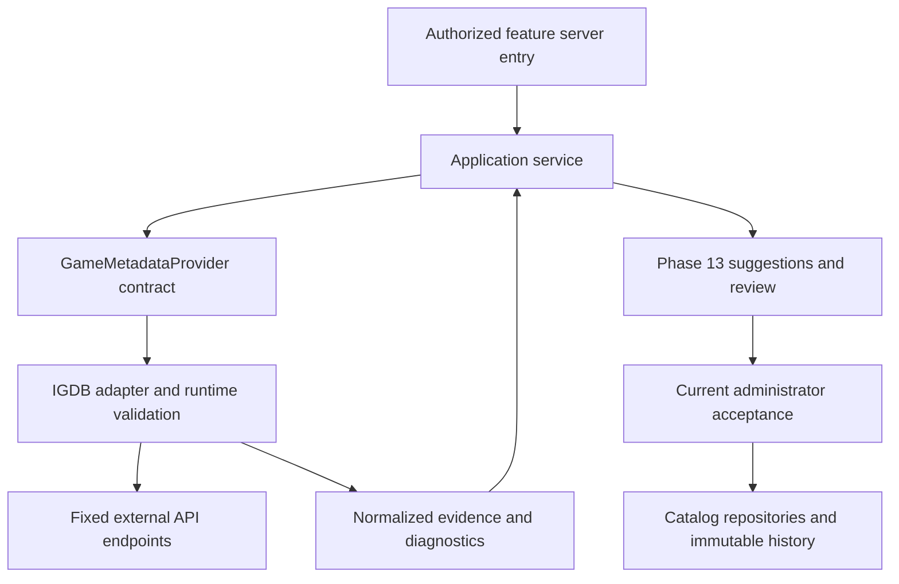

# GemuKore — Game Metadata Provider Architecture

Task: **12.1 — Provider Architecture**

Date: **2026-10-19**

Status: **Design complete.** This document defines the boundary for Task 12.2; it adds no provider implementation, configuration, migration, endpoint or enrichment UI.

Implementation follow-up: Task 12.2 implements the adapter and optional configuration described in [Game metadata integration](../operations/GAME_METADATA.md). The inspected repository state in §2 is historical to Task 12.1. Enrichment review and acceptance remain Phase 13.

## 1. Decision and scope

Use a server-only `GameMetadataProvider` with provider-neutral search and fetch contracts. A structured provider retrieves and normalizes evidence. Application services authorize requests, resolve local identities and, in Phase 13, prepare reviewable suggestions. Only a separate authorized acceptance operation changes canonical data.

IGDB-specific authentication, endpoint paths, query syntax, response schemas, numeric codes and mapping rules stay inside its adapter. A source label, external identifier or evidence link can identify IGDB outside the adapter; that is provenance, not a dependency on its response format. No provider DTO is a catalog mutation command.

This follows specification §§27–40, §§96–106 and the accepted decisions in [the architecture review](ARCHITECTURE_REVIEW.md), [domain model](DOMAIN_MODEL.md) and [repository architecture](REPOSITORY_ARCHITECTURE.md). Manual game creation remains usable with missing credentials or an unavailable provider. Structured lookup does not require AI. Future web/LLM synthesis and manual entry may share evidence and suggestion contracts without implementing this search/fetch interface.

## 2. Existing implementation and consequences

The following describes the repository inspected for Task 12.1, not functionality introduced here.

| Existing boundary                                                                                                             | Consequence for provider work                                                                                                                                                   |
| ----------------------------------------------------------------------------------------------------------------------------- | ------------------------------------------------------------------------------------------------------------------------------------------------------------------------------- |
| Game and GameRelease have separate identity, revision, archive state and local relationships.                                 | Fetching a broad game cannot create or select a physical release.                                                                                                               |
| `src/features/games/validation.ts` validates local catalog fields and relationship identifiers.                               | External IDs require explicit resolution before a proposal can refer to local companies, platforms or markets. Reuse domain validation at acceptance.                           |
| Catalog services recheck current permissions after the shared catalog lock and reject stale revisions.                        | Future acceptance must preserve this transaction/concurrency protocol. Provider requests run outside that transaction.                                                          |
| Current `appendCatalogHistory` records manual changes.                                                                        | Do not feed imports through manual actions and mislabel their history. Phase 13 needs an acceptance path with server-selected PROVIDER origin and immutable evidence snapshots. |
| ExternalReference already has explicit target FKs and target-local uniqueness.                                                | Use it for accepted mappings; do not add IGDB columns or a global one-provider-record/one-release uniqueness rule.                                                              |
| MetadataChange already supports origin and versioned source snapshots. EnrichmentRun and EnrichmentSuggestion remain planned. | Task 12.2 returns normalized results without inventing persistence or implementing Phase 13.                                                                                    |
| Screenshots use CatalogAsset and validated private Asset bytes. Trailers and playtime have separate sourced groups.           | An image URL is only a candidate; trailers use structured references; playtime replacement preserves whole-set semantics.                                                       |
| A persisted sourced-rating group is not implemented.                                                                          | Ratings may be returned as evidence in 12.2. Do not hide accepted ratings in arbitrary JSON or introduce persistence in this design task.                                       |
| No `src/server/providers/` implementation or IGDB environment variables exist.                                                | Add only the needed adapter/configuration in 12.2. No credentials or live-provider success are assumed here.                                                                    |

## 3. Layers and proposed modules



Proposed Task 12.2 paths, created only when that task is authorized:

```text
src/server/providers/game-metadata/
  contracts.ts       # neutral server contracts and bounded result schemas
  igdb.ts            # adapter orchestration and provider query construction
  igdb-mapping.ts    # validated provider records -> neutral evidence
  http.ts            # bounded transport used by this adapter
src/server/config/game-metadata.ts
```

Keep raw IGDB schemas beside the adapter, splitting a validation file only if needed. Prefer native fetch; no SDK, registry, plugin discovery, universal provider factory or new dependency is required by this design. One explicit server composition point selects the IGDB implementation. Inject transport/clock dependencies for tests, not arbitrary endpoint URLs from clients.

Adapters import their contracts, validation, server configuration and bounded transport helpers. They do not import React, feature actions, Prisma, repositories or catalog/enrichment services. Services may depend on the interface but never inspect raw provider fields. Feature DTOs expose only the serializable information needed for a future authorized review; AbortSignal, tokens, query bodies and raw responses never cross that boundary. Preserve repository import restrictions and add provider-specific checks with implementation.

## 4. Search and fetch contract

The following is an illustrative contract, not source code added by Task 12.1. Its named result payloads are specified in §5. External IDs are strings even when a provider uses numbers; a local UUID is never substituted for an external ID.

```ts
type ProviderId = "IGDB"; // Extend deliberately when another adapter is implemented.

type ProviderObjectRef = {
  provider: ProviderId;
  objectType:
    | "GAME"
    | "PLATFORM"
    | "COMPANY"
    | "COMPANY_CREDIT"
    | "RELEASE_DATE"
    | "COVER"
    | "SCREENSHOT"
    | "ARTWORK"
    | "VIDEO"
    | "PLAYTIME";
  externalId: string;
};

type GameSearchInput = {
  query: string;
  platform?: ProviderObjectRef;
  year?: number;
  cursor?: string;
  limit: number;
};

type GameFetchInput = { game: ProviderObjectRef };

type ProviderContext = {
  signal: AbortSignal;
  deadlineAt: number; // Monotonic clock deadline, enforced through body reading.
};

type ProviderErrorCode =
  | "NOT_CONFIGURED"
  | "INVALID_INPUT"
  | "NOT_FOUND"
  | "AUTHENTICATION_FAILED"
  | "RATE_LIMITED"
  | "TIMEOUT"
  | "CANCELLED"
  | "UNAVAILABLE"
  | "INVALID_RESPONSE";

type ProviderResult<T> =
  | { ok: true; data: T }
  | {
      ok: false;
      error: {
        code: ProviderErrorCode;
        retryable: boolean;
        retryAfterSeconds?: number;
      };
    };

interface GameMetadataProvider {
  readonly id: ProviderId;
  search(
    input: GameSearchInput,
    context: ProviderContext,
  ): Promise<ProviderResult<GameSearchPage>>;
  fetch(
    input: GameFetchInput,
    context: ProviderContext,
  ): Promise<ProviderResult<GameMetadataResult>>;
}
```

Validate inputs again at the adapter boundary. Search takes a trimmed 2–200 character public catalog query, a limit of 1–20, an optional valid calendar year and, if present, a PLATFORM reference belonging to this provider. Fetch requires its provider's GAME reference. Object types preserve distinct source namespaces: cover ID 42 and screenshot ID 42 cannot share one MEDIA identity. Never accept a query language, requested field list, API path, target URL or a submitted credential.

Search returns an ordered page of lightweight candidates: external game reference, title, bounded aliases, optional description excerpt, platform references/names, partial first-release evidence and a neutral relationship classification. Results have no local catalog IDs. Any matching explanation is informational; ordering is not verified identity or a confidence probability. An empty search is successful, while fetching a missing selected game returns NOT_FOUND.

Use bounded pagination: at most 20 candidates per request and an offset ceiling of 1,000. An optional opaque, versioned cursor carries only the validated position and normalized search fingerprint; reject malformed, mismatched or out-of-range cursors. It is never a URL or an authorization token. Do not automatically crawl all pages or recursively fetch related games.

Expected operational failures return sanitized typed errors, without response bodies, credentials or provider query strings. A service maps them to stable user-facing text. Unexpected programming errors can propagate to normal server error handling with redacted logs. A valid core record with unusable optional fields returns partial evidence and diagnostics; malformed core identity or an oversized/unparseable body fails the operation.

## 5. Normalized evidence

Use a versioned, serializable result envelope with `schemaVersion: 1`, the selected provider game reference, a retrieval timestamp, an adapter mapping version, bounded diagnostics and per-section availability. Sections distinguish **present**, **absent**, **unsupported**, **invalid** and **limited**. Partial arrays carry their limited state. Missing data never means a proposed deletion.

Every usable fact carries evidence: provider/object reference, safe source-page URL when available, source field path, retrieval timestamp, optional provider update/observation timestamp and the normalization applied. Keep the original scalar when a unit or precision changes. An API access token, request header, raw response or private collection field is never evidence. Shared evidence entries may be referenced by stable result-local IDs to avoid duplication.

Facts also declare their scope: broad game evidence, or a named release observation. Release observations are evidence groups, not GameRelease records. A field attached only to a broad game cannot acquire physical-release specificity merely because the user opened a release page.

The result shapes use the named records in the table below. `Sourced<T>` wraps a value with evidence IDs and its explicit scope; those IDs must resolve within this result. The search envelope uses the same retrieval/mapping provenance but contains lightweight candidates rather than full metadata sections.

```ts
type Section<T> =
  | { state: "present" | "limited"; data: T }
  | { state: "absent" | "unsupported" | "invalid" };

type Sourced<T> = {
  value: T;
  evidenceIds: string[];
  scope: { kind: "GAME" } | { kind: "RELEASE_OBSERVATION"; key: string };
};

type GameSearchPage = {
  schemaVersion: 1;
  provider: ProviderId;
  retrievedAt: string; // Valid UTC ISO timestamp.
  mappingVersion: string;
  candidates: GameSearchCandidate[];
  nextCursor: string | null;
  evidence: EvidenceSource[];
  diagnostics: ProviderDiagnostic[];
};

type GameMetadataResult = {
  schemaVersion: 1;
  provider: ProviderId;
  retrievedAt: string;
  mappingVersion: string;
  identity: GameIdentity;
  description: Section<Sourced<string>>;
  platforms: Section<Sourced<PlatformEvidence>[]>;
  releases: Section<Sourced<ReleaseObservation>[]>;
  companies: Section<Sourced<CompanyCreditEvidence>[]>;
  images: Section<Sourced<ImageCandidate>[]>;
  videos: Section<Sourced<VideoCandidate>[]>;
  ratings: Section<Sourced<RatingEvidence>[]>;
  playtime: Section<Sourced<PlaytimeEvidence>>;
  evidence: EvidenceSource[];
  diagnostics: ProviderDiagnostic[];
};
```

Diagnostics contain a stable code, section and optional result-local item key, with a bounded safe description; they never echo a raw record. Validate that all referenced evidence and observation keys exist, references belong to the expected provider and sections cannot contradict the selected identity. Identity includes its own evidence IDs for names, aliases and relationships.

| Section              | Normalized representation and rules                                                                                                                                                                                                                                                                                                     |
| -------------------- | --------------------------------------------------------------------------------------------------------------------------------------------------------------------------------------------------------------------------------------------------------------------------------------------------------------------------------------- |
| Identity             | GAME reference, display title, aliases and neutral relationship evidence such as original/port/remake/remaster/compilation/unknown. Preserve related external references for explanation without merging or following them automatically.                                                                                               |
| Description          | Plain text only, with no executable markup. Retain attribution; do not silently combine conflicting descriptions.                                                                                                                                                                                                                       |
| Platforms            | PLATFORM references plus names. These describe software platforms, not ConsoleModel hardware variants.                                                                                                                                                                                                                                  |
| Release observations | Stable observation key, source record reference, game/platform references, optional commercial-market evidence and a valid partial calendar date. Retain date precision and status; no fabricated January 1, day or month. Unknown market is not worldwide.                                                                             |
| Companies            | COMPANY reference, name and explicitly evidenced role. A release-specific credit refers to its observation key and market only when supported. Missing role/scope stays unresolved; a broad credit cannot establish a particular release's publisher.                                                                                   |
| Images               | Candidate reference, safe HTTPS locator, dimensions if known, purpose such as cover/screenshot/artwork/unknown, scope, source and rights information if supplied. Unknown rights and unknown physical-artwork suitability remain explicit. No Asset ID or public approval.                                                              |
| Videos               | Candidate reference, title, scope and a validated structured YouTube ID or direct HTTPS reference supported by the existing trailer domain. No embed HTML, arbitrary iframe URL, executable player configuration or automatic playback. Unsupported types remain diagnostics.                                                           |
| Ratings              | Separate sourced groups with kind COMMUNITY/CRITIC/COMBINED, finite value, declared positive scale maximum, optional sample count and timestamps. Require `0 <= value <= maximum`; missing/invalid scales are unusable. Age certifications and personal scores are different concepts. Never average the groups or choose one silently. |
| Playtime             | One sourced provider estimate set, with nullable main/main-plus-extras/completionist minutes, optional sample count and original units/values. Preserve source scope. An empty set is absent, not three measured zeros. This is completion-time evidence, not the owner's play history.                                                 |

Initial normalized ceilings: title/name 200 characters, description 16,000, aliases 30, platforms 30, release observations 30, company credits 60, images 20, videos 5, rating groups 3 and diagnostics 50. Limits are per result, not per upstream page. Omit invalid optional facts with a bounded reason; truncate arrays deterministically and mark them limited. Never truncate an external identifier into a different valid identity. Revalidate accepted proposals against the existing, possibly stricter domain constraints.

Provider data may contain additional facts that the current schema cannot store. Keep only declared normalized evidence needed by the task. Do not turn unknown response fields into an unbounded metadata bag. A bounded diagnostic identifies an unsupported field/category; it does not preserve an entire raw payload.

## 6. Identity and local relationship resolution

Resolution belongs to application services, outside the adapter:

1. Resolve an existing accepted ExternalReference for the intended local target when available. Validate provider and object type; do not use a bare numeric ID across object types.
2. Otherwise search with public catalog terms and show candidates for explicit selection. Similar names, years or artwork help disambiguation but never establish identity by themselves.
3. Fetch the selected GAME reference and keep its broad identity distinct from release observations. A port may belong to an existing Game; a materially distinct remake may need another Game. Remasters, compilations and ambiguous relationships require curation rather than an adapter's merge rule.
4. Resolve external platforms, companies and commercial markets through accepted local mappings. An ambiguous/missing mapping remains unresolved; name matching cannot create a company or equate a hardware model with a platform. A Genesis/Mega Drive naming difference needs an explicit reviewed mapping, not a second platform generated by the adapter.
5. For a GameRelease target, require the existing local game/platform/edition/printing/market identity to remain fixed. Provider platform/date information alone does not prove a boxed edition, printing, barcode, package contents, cover region or region lock. Do not infer an edition from a provider version title.
6. Produce only allowlisted proposals compatible with the selected target. Game-level facts may be proposed on Game; release-scoped facts need explicit compatible evidence. An unresolved relationship is a review issue, never a guessed UUID.

ExternalReference remains target-local: the same broad provider game can legitimately be referenced by several physical releases. Preserve provider/object/external-ID namespaces, explicit target FKs, normalized safe evidence URLs and existing uniqueness rules. A new ID-based reference must include object type. Provider identity is not a globally unique product identifier; barcodes also retain leading zeros and cannot be used as a universal release merge key.

## 7. IGDB adapter decisions

### Verified provider constraints

IGDB uses Twitch client credentials and Client-ID/Bearer request headers. Its documented limits are four requests per second and eight open requests. Current fields include `game_type`/`game_status` and release-date `date_format`/`release_region`; older counterparts are deprecated. Ratings distinguish community, aggregated critic and combined scores. Time-to-beat `hastily`, `normally` and `completely` are seconds for credits-focused, extras-inclusive and completionist estimates. [Official IGDB API documentation](https://api-docs.igdb.com/).

Twitch's client-credentials flow obtains an app access token from the token endpoint and returns an expiration interval. Use its documented form-body request rather than placing secrets in logged URLs. [Official Twitch token documentation](https://dev.twitch.tv/docs/authentication/getting-tokens-oauth/#client-credentials-grant-flow).

### Application mapping policy

These are GemuKore decisions. Recheck the upstream schema in Task 12.2 and cover its actual payloads with fixtures; do not hardcode deprecated numeric enum assumptions.

| Concern                        | Adapter rule                                                                                                                                                                                                                                                                                                 |
| ------------------------------ | ------------------------------------------------------------------------------------------------------------------------------------------------------------------------------------------------------------------------------------------------------------------------------------------------------------ |
| Game records and relationships | Map to neutral identity evidence. Unknown categories/statuses produce unknown classifications and diagnostics; they do not become local editions.                                                                                                                                                            |
| Dates and regions              | Translate only documented precision and explicitly mapped commercial regions. A timestamp at a placeholder date cannot supply precision the source does not claim. Platform/market/date associations stay together.                                                                                          |
| Companies                      | Normalize evidenced roles separately. Developer evidence may describe Game; publisher/distributor/port-developer evidence needs its supported scope. No automatic local company creation.                                                                                                                    |
| Covers and screenshots         | Preserve purpose and broad scope. A game cover is not verified regional box artwork; a screenshot is not a copy photograph. Construct image locators only from validated provider image identifiers and fixed HTTPS hosts.                                                                                   |
| Videos                         | Validate provider video identifiers through the structured trailer rules. A label containing “trailer” is not permission to select or publish it.                                                                                                                                                            |
| Ratings                        | Keep the three rating kinds distinct with validated scales and counts. A later review explicitly chooses an eligible group. Do not persist all three as one scalar or reinterpret a certification as a score.                                                                                                |
| Playtime                       | Map hastily → main, normally → main-plus-extras, completely → completionist, labeled as provider estimates. For a positive finite duration, convert seconds with `max(1, round(seconds / 60))` and record original seconds plus the conversion. Do not invent missing categories or enforce ascending times. |
| Ambiguous zeros                | Treat missing samples or zero values with unverified sentinel semantics as unavailable evidence with a diagnostic. Only emit a measured zero when supported by established provider semantics/fixtures. This does not change canonical playtime's existing distinction between explicit zero and null.       |
| Timestamps                     | Keep retrieval time separate from provider update/observation time. If only retrieval time is available, say so in evidence; never claim that the provider measured the estimate at that instant.                                                                                                            |

One accepted GameRelease playtime set replaces the whole Game default. Do not fill its null categories from another set. Likewise, rating inheritance selects a whole sourced group. Retrieval offers evidence; acceptance and fallback display rules remain application responsibilities.

## 8. Configuration, transport and budgets

Task 12.2 introduces optional server-only `IGDB_CLIENT_ID` and `IGDB_CLIENT_SECRET` together with their validation and example-file documentation. Validate paired credentials when enabling provider use; their absence disables lookup without breaking manual flows, builds or existing features. No `NEXT_PUBLIC_*` credential. No automatic request at module import, startup, page render or build time.

Cache an app token only in server memory, reuse it before expiry with an early-expiry margin, and collapse concurrent token acquisition within that process. Never persist it in catalog records, source snapshots, browser storage, logs or error messages. Authentication failure may invalidate and reacquire once within the same operation budget; do not retry indefinitely. Tokens and credentials do not participate in public caches.

Initial application limits, deliberately below upstream capacity:

| Resource                     | Bound                                                                                                                                                                                                                                           |
| ---------------------------- | ----------------------------------------------------------------------------------------------------------------------------------------------------------------------------------------------------------------------------------------------- |
| Whole search/fetch operation | 30 seconds, including token acquisition, scheduling, retries, decoding and normalization; caller cancellation applies throughout.                                                                                                               |
| Individual HTTP attempt      | At most 8 seconds, clipped to remaining operation time.                                                                                                                                                                                         |
| Total HTTP attempts          | At most 8, including retries: at most 2 token attempts and 6 data attempts. Batch related IDs/expand selected fields to fit; do not start recursive fan-out.                                                                                    |
| Scheduling                   | At most 2 data starts per second and 2 in flight per credential/process; token acquisition is single-flight. If capacity cannot be admitted within the deadline, fail with a typed temporary error.                                             |
| Retry                        | At most one retry for a given transient failed request; only rate-limit, transport or temporary-server failures. Honor valid Retry-After within the remaining deadline, otherwise return RATE_LIMITED. Input/validation errors are not retried. |
| Streamed bodies              | At most 2 MiB per data response, 64 KiB per token response, enforced on received/decompressed bytes even without Content-Length. Abort oversized bodies.                                                                                        |
| Normalized output            | At most 512 KiB serialized; if it cannot fit after deterministic optional-section limiting, return INVALID_RESPONSE.                                                                                                                            |
| Media bytes                  | No image/video downloads during search/fetch. Later authorized ingestion has its own storage validation and byte/pixel budgets.                                                                                                                 |

Per-process scheduling is not an aggregate guarantee across replicas or other tools sharing credentials. Document that limitation in 12.2, handle upstream throttling conservatively and avoid claiming distributed enforcement. Multi-instance quota coordination, if actually needed, must be designed within the existing application/database architecture; this task does not authorize Redis, workers or a persistent queue. Diagnostics distinguish budget-limited optional sections from a complete absence of source data.

### Request and URL safety

- Compile endpoint and field allowlists in the adapter: fixed HTTPS IGDB v4 endpoints and the fixed Twitch token endpoint. Validate numeric provider IDs with bounded safe-integer rules; escape search literals using tested provider-query rules. Never concatenate unvalidated query syntax.
- Reject redirects for authenticated requests. Require TLS/443, no URL userinfo and no arbitrary host/port/path substitution. Return only validated HTTP(S) source-page references without credentials; media candidates require HTTPS and an explicitly supported host/type.
- API retrieval never fetches a source-page or media URL. Later image ingestion must separately validate an allowlisted destination and all resolved addresses, reject private/loopback/link-local/metadata destinations including IPv6 forms, and prevent DNS rebinding by validating the actual connection destination. A DNS precheck followed by unconstrained fetch is insufficient. Revalidate every redirect or reject redirects entirely.
- Send no private notes, serials, locations, photos, authentication identity or collection payloads upstream. Construct requests from a deliberate allowlist of public catalog search fields; do not serialize a catalog/copy object or forward arbitrary freeform notes as a search query.
- Use server-side no-store requests. Bound and redact logs to operation, error code, latency and counts; omit tokens, raw bodies, query text and full URLs containing parameters. No shared public response cache or cross-user enrichment-result cache is introduced.

Provider-origin image URLs must not be hotlinked into a new browser preview automatically. Phase 13 can use text/placeholders until validated authorized asset ingestion exists. A candidate URL does not bypass private delivery, rights review or publication policy.

## 9. Provenance and the Phase 13 handoff

Task 12.2's boundary ends at normalized evidence. It does not save accepted mappings, create runs/suggestions, alter revisions or expose unfinished enrichment controls. Phase 13 implements the already-planned review workflow:

1. Require current `enrichment.suggest` for retrieval/proposal; EDITOR and ADMIN qualify under current permissions. Recheck the local target and permitted fields server-side. Persist a run with the explicit target FK, request key, base revision, selected candidate and bounded versioned result/evidence snapshots. A completed fetch is not an accepted change.
2. Convert facts into allowlisted suggestions showing current value, proposed value, scope and evidence. No confidence is required; include it only with a named method, never equate search position with certainty. Missing/invalid facts cannot clear existing values. Relationship mappings and new catalog records need explicit authorized review.
3. Require current `enrichment.accept`/catalog-management authority for application. After taking the shared catalog lock, recheck the grant, target/archive state, run selection and root revision. A changed revision conflicts conservatively; never silently refresh the base. Validate every selected proposal against current domain/relationship rules.
4. Apply the explicit eligible pending selection atomically, increment the root revision once and append immutable per-field MetadataChange records with server-chosen origin, actor and versioned evidence snapshots. Idempotent request/suggestion linkage prevents duplicate application. “Apply all” means the displayed eligible proposals, not every field in an upstream response. Replacing manually entered data requires an explicit displayed choice.
5. Keep network/asset-byte work outside the catalog transaction. Attach only validated READY assets with provenance and appropriate rights/use metadata. A new/replaced trailer, cover or screenshot receives no automatic public approval. Ingestion cannot reuse an upload route by forging a user upload or trusting remote MIME headers.

Reuse catalog validation and repository mutation rules without routing accepted provider values through functions that hardcode MANUAL history. Extraction of shared mutation mechanics belongs to the Phase 13 implementation, with tests proving origin/provenance and transaction behavior. Do not accept client-selected history origins or source snapshots as authoritative.

The provider contract carries no owned-copy mutation or publication instruction. Applying canonical information does not rewrite copy-specific overrides, notes, defects, locations or publication state. Source timestamps, unknown rights and partial evidence survive review rather than being replaced with fabricated certainty.

## 10. Implementation and verification handoff

### Task 12.2 — IGDB Integration

- Implement the bounded server-only search/fetch adapter and strict raw/normalized validation, using the contract and mappings above. Include release observations, companies, image/video candidates and separate rating evidence; support usable playtime evidence when supplied, without changing its domain semantics.
- Add optional configuration and a documented server composition point. Do not add a user-facing enrichment workflow or persistence before Phase 13.
- Exercise successful and empty search, selected-game retrieval, partial optional data, cancellation, token reuse/expiry, throttling, timeout, byte limits and sanitized failure behavior with deterministic transport fixtures. Prove no network on import/build and manual functionality without provider configuration.
- Run applicable lint/typecheck/unit and boundary checks. Existing database/browser suites apply if integration changes their behavior; they must not depend on live IGDB credentials. A credentialed smoke check is optional and must be reported separately from fixture coverage.

### Task 12.3 — Provider Mapping Tests

Expand fixtures without changing the architecture: unknown/deprecated codes, partial dates and unknown regions, ports/remakes/compilations, duplicate or mismatched IDs, scoped company credits, incomplete arrays, malformed media, rating scales/kinds, playtime units/zeros/samples and source timestamps. Add adversarial query, URL, redirect, pagination, streamed-body and retry-budget cases. Assert normalized DTOs contain no raw response objects, credential material or local IDs manufactured from provider IDs.

### Phase 13 — Enrichment and acceptance

Implement run/suggestion persistence, candidate selection, review, provenance and guarded application in their assigned tasks. Verify editor/admin separation, stale revisions, manual replacement, idempotent partial acceptance, validated private media, and manual creation during provider failure. Remaining suggestions after partial acceptance require a fresh review against the new root revision; do not silently advance their baseline.

## 11. Task 12.1 completion criteria

- Provider-specific I/O and schemas are confined to a proposed adapter boundary.
- Neutral inputs/results, partial evidence, errors, identity resolution, provenance and finite budgets have concrete contracts.
- Existing manual workflows, catalog layers, privacy and review permissions remain intact.
- Provider facts are checked against primary documentation; live connectivity, asset rights and production quota capacity are not claimed.
- Only this architecture document, its README link and the development-plan status change in this task. Documentation checks validate formatting, local references and patch integrity; runtime suites are not evidence for an adapter that has not yet been implemented.
