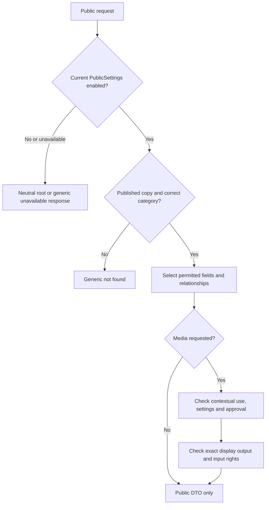

# GemuKore — Public Privacy Architecture

Task: **18.1 — Public Privacy Architecture**

Date: **2026-10-21**

Status: **Design complete.** Implementation belongs to Tasks 18.2–18.7. Publication remains disabled by default.

Task 18.2 implements the server query and publication-command portion of this handoff; see [Public query operations](../operations/PUBLIC_QUERIES.md) for current contracts, transaction coordination, verification and capabilities still reserved for later tasks. The baseline evidence below remains the historical input to this design.

## 1. Authority and scope

This refines [PROJECT_SPEC.md](../../PROJECT_SPEC.md) §§12, 54, 61, 69, 79–86, 109–110 and 135, the [domain publication contracts](DOMAIN_MODEL.md#6-assets-uses-and-provenance), and the [repository output/delivery boundary](REPOSITORY_ARCHITECTURE.md#8-public-projections-media-delivery-and-caching). It preserves the separate canonical catalog and owned copies, existing UUID routes, administrator-only publication, private object storage and current-policy/no-store delivery. It does not introduce another global toggle, authentication product, service, cache or asset ownership model.

An anonymous visitor and a signed-in administrator receive the same public projection. Public services do not accept a private-access context or a client-selected audience. Private management stays under `/app/...`; a public page has no private preview mode. An administrator preview uses an authenticated private route and explicitly labelled public DTO, with private no-store headers.

Every failed media gate denies that representation; it does not fall through to a private URL. Settings or database failures never fabricate an enabled policy or an empty successful collection.

## 2. Repository baseline and gaps

The inspected baseline is commit `dd84d34`.

| Existing evidence                                                                                                                                                                                                                            | Consequence for Phase 18                                                                                                                                                                           |
| -------------------------------------------------------------------------------------------------------------------------------------------------------------------------------------------------------------------------------------------- | -------------------------------------------------------------------------------------------------------------------------------------------------------------------------------------------------- |
| [Schema](../../prisma/schema.prisma): singleton `PublicSettings`, all seven booleans false; `AppSettings` has no publication toggle.                                                                                                         | Reuse these owners and revision fields. A missing policy row denies publication. Do not infer enablement from environment configuration or AppSettings.                                            |
| `CollectionItem.publicationStatus` defaults PRIVATE with publication time/actor fields; all three creation services explicitly create PRIVATE copies.                                                                                        | No bulk publication when global enablement changes. Canonical records without a published owned copy are outside public collection queries.                                                        |
| Catalog, item and application asset uses have `publicApproved`, a pinned `publicDisplayAssetId`, approval time/actor; database guards clear approval on changed use content.                                                                 | Approval is per relationship and exact display output, not an asset-wide publication grant. Deleted approver accounts may null attribution without invalidating retained approval.                 |
| Assets have immutable byte identity, delivery class, content review, rights and fixed dependency edges.                                                                                                                                      | Re-evaluate current output and input rights. Neither a DISPLAY derivative nor `publicSafe` alone establishes public access.                                                                        |
| [Reserved public search SQL](../../src/server/repositories/search/query.ts) and its [integration case](../../tests/integration/search.test.ts) already separate published roots, permitted notes/defects, and excluded serial/repair search. | Reuse this audience-specific query contract after review. It currently exposes no public service or endpoint; do not call private filtered search or private card hydration from a public service. |
| [Private asset HTTP delivery](../../src/server/http/assets.ts) authenticates and streams objects. Only `/api/media/private/[id]` exists.                                                                                                     | Build a distinct contextual public resolver/error contract. Calling `privateAsset` with a visitor session is not public authorization.                                                             |
| `GameReleaseIncludedItem.presentationApproved` and trailer approval booleans exist; ordinary changes reset them. Component reviewer/time fields and public presentation/delivery services do not exist.                                      | Complete component approval persistence before accepting public component approvals. Existing private template/model descriptors cannot be serialized publicly.                                    |
| Copy edits conservatively unpublish meaningful changes, including some private-only changes. Photo/defect workflows use their relevant visibility setting.                                                                                   | Keep the stricter existing behavior. Audit shared catalog/location edits and settings concurrency before enabling public reads; do not relax invalidation while building this phase.               |
| No public museum routes, settings/publication management workflow or public media handlers exist. Root metadata currently disallows indexing.                                                                                                | This task documents the contract only. A seeded PUBLISHED row or a manually changed database flag does not make the missing capabilities implemented.                                              |

These are implementation prerequisites, not a change to the accepted architecture. The earlier domain/storage documents intentionally assigned public execution to Phase 18.

## 3. Exact PublicSettings behavior

All policy-dependent services load `PublicSettings(id=1)` within their read transaction. Only the service chooses which settings affect a projection. Unknown client properties, audience overrides and private control parameters are rejected by strict public input validation.

| Setting                     | When false                                                                                                          | When true, with global enablement and a published copy                                                                                                                                                                                                                                                                                                                                      |
| --------------------------- | ------------------------------------------------------------------------------------------------------------------- | ------------------------------------------------------------------------------------------------------------------------------------------------------------------------------------------------------------------------------------------------------------------------------------------------------------------------------------------------------------------------------------------- |
| `publicCollectionEnabled`   | No collection data/media; only the generic root message.                                                            | Allows evaluation of the remaining gates. It publishes no copy or media use by itself.                                                                                                                                                                                                                                                                                                      |
| `showSerialNumbers`         | Do not select or return owned serials.                                                                              | The detail DTO may include the selected copy's serial as text, preserving leading zeros. Serial matching, filtering, ranking and suggestions remain private, as required by the search contract.                                                                                                                                                                                            |
| `showLocations`             | No location fields, joins for public ordering/matching, labels, options or breadcrumbs.                             | Detail may disclose the assigned location name, type and ancestor names in a breadcrumb. This is precise location disclosure and must be labelled accordingly in admin review. A public location filter, if offered, contains only locations reached from published copies. No location descriptions, unused hierarchy, assignment counts from private copies or location-management links. |
| `showNotes`                 | Notes cannot affect projection, matching, ranking, counts or snippets.                                              | Detail may include the copy's notes as escaped plain text; public search may match those notes on published copies.                                                                                                                                                                                                                                                                         |
| `showDefects`               | No defect presence/count/labels, filters, search matches or condition claims derived from defects.                  | Detail may include title, description, severity and status; public search may match title/description. Unresolved means ACTIVE or ACCEPTED; active means ACTIVE only. Repair notes, repair dates, actors and history remain private. An empty list means no records, not confirmed defect-free.                                                                                             |
| `showPersonalPhotos`        | No personal photos, custom logos/models or personal overrides, even if individually approved.                       | Eligible, individually approved item uses may appear. This never approves their bytes or opens their private URLs. Canonical media has its own approval path and does not require this personal-media setting.                                                                                                                                                                              |
| `allowSearchEngineIndexing` | Public pages/media remain accessible if otherwise eligible, with noindex/nofollow and no published sitemap entries. | Permits indexing controls only for eligible public content. It does not enable the museum or reveal hidden fields. Until Task 18.6 implements these controls, preserve noindex/nofollow regardless of this stored value.                                                                                                                                                                    |

Changing a visibility flag from false to true expands the projection that an item approver previously reviewed. The settings command must preview that impact and **atomically return affected PUBLISHED copies to PRIVATE**, clearing publication time/actor and advancing their revisions. Affected means copies with a newly exposed serial, location, note, defect, or approved personal-media use, as applicable. The union is invalidated once when several flags widen together. Copies without newly exposed content retain their status. Administrators then review and republish affected copies under the new settings. This avoids adding per-field publication approval tables and ensures a global flag cannot silently authorize previously hidden edits.

Disabling the global toggle retains individual publication/approval choices as a pause; enabling it again requires an administrator's explicit current-policy review and retains those choices. Narrowing a visibility flag immediately suppresses that field/use without approving anything else. Turning a flag on again uses the widening rule. Changing indexing alone does not unpublish copies. Settings changes are revision-checked, server-authorized operations; setting values submitted with a copy/media form cannot change policy.

## 4. Public field and DTO allowlists

Public repositories select only the permitted columns. Conditional field selection is decided before the query; omitting a key after a full private read does not satisfy this boundary. Safe DTO construction maps a narrow repository result and never spreads an ORM aggregate. Gates and internal lookup IDs may be read for enforcement but do not become display data.

| Output                          | Permitted content                                                                                                                                                                                                                                                                                                                                                       |
| ------------------------------- | ----------------------------------------------------------------------------------------------------------------------------------------------------------------------------------------------------------------------------------------------------------------------------------------------------------------------------------------------------------------------- |
| Root/site identity              | Reviewed `AppSettings.collectionName` and `collectionDescription` while enabled, plus independently approved application logo. Default application branding otherwise. Theme/currency/timezone/settings revisions are not site metadata.                                                                                                                                |
| Item card / search hit          | Owned UUID and category, canonical title/context, public copy link, catalog platform/model/release/variant labels, optional eligible image. Box state may be true/false/unknown; never infer completeness. No owned serial/location/notes in cards or autocomplete.                                                                                                     |
| Console detail                  | Published copy identity, allowlisted platform/model facts and specifications, commercial markets, manufacturer, identification caveat and eligible media.                                                                                                                                                                                                               |
| Game detail                     | Published copy identity, allowlisted Game/GameRelease facts, edition/printing, platforms, markets, scoped credits/identifiers, canonical descriptions, shared playtime estimates, expected flat contents and eligible media. Expected contents do not claim the owned copy has those components; owned component observations are not implemented and are not invented. |
| Accessory detail                | Published copy identity, allowlisted family/variant facts, producer, market and explicit platform compatibility. Family fallback and variant-specific values retain truthful scope labels.                                                                                                                                                                              |
| Optional personal detail fields | Only the corresponding settings-controlled serial, location, notes and defect projections from §3.                                                                                                                                                                                                                                                                      |
| Asset attribution               | Independently reviewed public author/attribution/license text and normalized public links needed for the displayed output. No raw provenance or provider snapshots. Public links must not contain credentials, private signed parameters, identifying filenames or internal locators; ambiguous links are omitted.                                                      |
| Counts / featured / facets      | Only individually published copies passing the same query policy. Duplicates count as physical copies. Newest selection may use creation time internally; internal timestamps/revisions and publication actors are not added to public DTOs.                                                                                                                            |
| Metadata / OpenGraph / sitemap  | A smaller canonical title/description/URL and independently eligible image projection. Never use serials, precise locations, notes, defects, account data or private counts here, even when detail disclosure is enabled.                                                                                                                                               |

Always exclude account/access/session information, serial search indexes, observed markings, location descriptions, defect repair notes/history, acquisition/financial data, creator/updater/publisher/reviewer IDs, private URLs, original filenames, object keys/namespaces, hashes, raw JSON metadata, enrichment queries/results and audit snapshots. No setting enables these fields. Canonical commercial product codes are distinct from a copy's serial number.

Canonical descriptions/specifications are explicitly mapped and rendered as text or known validated structures; raw database/provider JSON is never a public props shortcut. Safe existing presentation formatters may be reused with a public input contract; private detail DTOs and provenance/history services may not.

## 5. Public queries, routes and errors

Planned server boundaries follow the existing architecture:

- `src/features/public-collection/`: public DTOs, strict validation and thin `queries.server.ts` entry points.
- `src/server/services/public-collection/`: `getPublicCollection`, `getPublicConsole`, `getPublicGame`, `getPublicAccessory`, public search/summary and contextual media coordination.
- `src/server/repositories/public-collection/`: explicit public predicates and field projections, accepting the service transaction. Shared low-level SQL fragments are allowed only when they preserve the public input/projection contract.
- Private publication/settings commands use current `publication.manage` / `settings.manage` authorization; public read services never obtain private access on behalf of a visitor.

These are planned files, not scaffold requests. Pages call feature queries directly from Server Components; browser search uses the separate planned `/api/search/public` handler. Never make a server page call its own HTTP API.

A multi-read public service starts a short Repeatable Read transaction, reads current policy first and keeps item selection, count, optional-field selection and media relationship resolution in that snapshot. It returns bounded safe DTOs; object storage/network transfer happens after the transaction. Public query methods cannot be switched to private mode by a cookie, role, header, query string or input property.

Apply global enablement and PUBLISHED roots **before** search matches, filtering, ranking, pagination, totals, overflow detection and facet construction. Notes and defect matching require their respective gates. Serial/repair text never participates. The existing public search builder has no private structured-control argument: extending it must use a separate public allowlist rather than passing the private `controls-query` expression through. Never hydrate its IDs with the dashboard/private card resolver, which selects private media and unresolved defects.

Two copies of one catalog identity have different URLs. Public detail `[id]` is the owned UUID, with a category check; catalog IDs/slugs are not aliases for owned copies. Retained archived canonical identities can still describe published copies, as they do privately. No unowned catalog directory or independent asset listing is introduced.

| Condition                                                            | Public behavior                                                                                                                                    |
| -------------------------------------------------------------------- | -------------------------------------------------------------------------------------------------------------------------------------------------- |
| Disabled or missing settings, `/collection`                          | Fixed “This collection is currently private.” message. No configured collection name, counts, images, account hints or private navigation payload. |
| Disabled policy or invalid/nonexistent/private/wrong-category detail | Same generic 404, headers and public error body. Do not echo private titles or distinguish these cases with redirects.                             |
| Disabled public list/search/media endpoint                           | Generic 404; no successful empty payload suggesting publication is enabled.                                                                        |
| Enabled, zero published matches                                      | Successful empty public result with zero counts drawn only from published roots.                                                                   |
| Database/policy service failure                                      | Generic unavailable response (503 where the transport permits), no diagnostic payload or fabricated empty result.                                  |
| Valid published copy with unavailable media                          | Preserve safe textual content and a neutral fallback. No private URL or original download alternative.                                             |

All payload forms count as outputs: HTML, RSC/Flight data, serialized props, JSON, metadata, errors, image headers, conditional and range responses. Generic 404 behavior does not claim constant-time indistinguishability. `/` moves to a consistent `/collection` redirect when Task 18.3 introduces the actual root; it remains the existing foundation preview during this design task.

## 6. Contextual media and derivatives

For public item media, require all of:

1. Enabled current policy and a PUBLISHED item of the correct category.
2. A server-resolved allowed relationship between that item and the requested use. A catalog use must belong to its actual model/platform, release/game/included component, or variant/family graph; arbitrary catalog/asset IDs are insufficient.
3. The relevant field/settings gate, including `showPersonalPhotos` for personal photos and custom model/logo uses.
4. `publicApproved=true`, approval time, and the explicit `publicDisplayAssetId` for that exact use. Do not fall back to `assetId` when the public pointer is absent. Null reviewer IDs after account deletion do not alone revoke historical approval.
5. Output state READY, delivery class DISPLAY, expected kind/validated MIME, `publicSafe=true`, review time and `rightsStatus=APPROVED`.
6. Current approved rights throughout the applicable fixed input lineage. Originals may be provenance inputs while remaining private; their `publicSafe` flag is not required. Unknown/restricted rights, missing inputs, invalid/cyclic lineage or an unsupported graph deny the representation. Traversal must be bounded and deduplicated, and exceeding its implementation limit denies access rather than skipping inputs.

Content approval includes visible pixels, embedded GLB textures, labels, captions and alt text. Metadata stripping is insufficient. In the initial public implementation, approved image/model bytes must exclude identifying serials, precise storage locations, private notes and account information regardless of text visibility flags. SERIAL-classified uses stay out of public galleries and direct delivery. A curator may create a sanitized DISPLAY output and a separately reviewed ordinary photo use; enabling serial text does not expose raw serial photographs. This conservative media profile refines the earlier default-exclusion contract without requiring the original to be publicly safe. It avoids inventing an untracked per-image sensitive-disclosure override. Any future disclosure profile for identifying imagery requires an explicit policy/storage extension.

The initial image endpoint serves the **exact pinned public display asset**. A thumbnail, crop, screenshot preview or rendered poster is not authorized merely because it shares a source with an approved image. Existing private thumbnail sibling discovery cannot be reused. A smaller derivative can be explicitly pinned and reviewed as the use's public display output; additional public variants need an explicit approved mapping before a variant selector is accepted. No arbitrary asset/hash/size parameter selects a public derivative. Gallery pagination, totals and overflow notices count only eligible public uses; unapproved media cannot influence a visible count or occupy hidden page slots.

Fallback is resolved from public candidates: approved personal override → independently approved canonical use in the correct scope → neutral placeholder. Preserve existing source precedence/labels and choose only eligible uses at each level. A private override never reaches the browser, including in an unused hidden descriptor. Screenshots, logos, covers, previews and uploaded videos use the same content/rights gates. Game/release and accessory-family/variant structured external trailers instead need their existing `trailerPublicApproved` group, the published item relationship and a validated reference; public review also rejects private/signed source URLs or credential-bearing parameters. They load only after user activation. An external provider link/iframe is not application-controlled byte delivery and cannot promise recall of previously supplied URLs.

Public 3D additionally requires a separate public presentation DTO. For component viewers, require `presentationApproved`, a valid selected template revision, the correct same-component/template slot bindings and eligible base geometry plus every delivered texture/poster. Procedural geometry has no file to authorize, but still requires approved presentation and validated code-owned parameters. An ORIGINAL base GLB cannot be silently replaced with an arbitrary derivative: explicitly curate/reassign eligible DISPLAY geometry and reapprove the presentation. Embedded images are reviewed as part of the GLB; separate textures pass their own checks. Missing optional artwork gets a neutral surface; an ineligible required resource prevents the interactive representation and uses an eligible static fallback. Whole-model fallback retains the existing source priority.

Generated previews, if introduced later, need fixed RENDER_INPUT dependencies on every contributing resource and independent output review. No preview generator, new renderer, owned component presence or worker is part of this task.

Use the existing planned context URLs:

| URL                                                             | Resolution                                                                                                                                                   |
| --------------------------------------------------------------- | ------------------------------------------------------------------------------------------------------------------------------------------------------------ |
| `/api/media/public/items/[itemId]/[useKind]/[useId]`            | `useKind` is `personal` or `catalog`; validate item association, media role and exact approved output. AppAsset and arbitrary table names are rejected here. |
| `/api/media/public/components/[itemId]/[componentId]/[slotKey]` | Item's selected release component and approved template; reserved geometry key or validated template slot. No arbitrary template or texture asset lookup.    |
| `/api/media/public/site/[useId]`                                | Approved COLLECTION_LOGO AppAsset while global publication is enabled. No item/personal-photo gate, but the same byte/rights rules.                          |

Site media is the explicit exception to the item gate, not an asset-wide public route. Component texture bindings use component presentation approval plus asset eligibility, since bindings have no independent media-use approval columns. Direct item/catalog use requests still require their own use approval. Before component approval is available, add nullable reviewer/time fields alongside `presentationApproved`: require a current ADMIN actor and timestamp on approval, permit actor nulling after account deletion, and clear legacy true flags without review time. A boolean with no recorded review is not grandfathered into public delivery.

## 7. Approval writes, edits and concurrent policy changes

Publication is a separate explicit ADMIN command, with current server reauthorization and a reviewed expected revision. Ordinary editor/admin copy forms cannot submit publication flags, approver IDs, asset review status or settings. ADMIN ordinary edits also invalidate approval when content changes; administrator role alone is not a replacement for the explicit approval command. A normalized no-op preserves existing revision/approval.

| Change                                                                                 | Required result                                                                                                                                                                                                                                                 |
| -------------------------------------------------------------------------------------- | --------------------------------------------------------------------------------------------------------------------------------------------------------------------------------------------------------------------------------------------------------------- |
| Publish/unpublish a copy                                                               | Lock/recheck current copy and policy, require `publication.manage`, review current projection; set/clear publication metadata atomically. Item publication may succeed with safe placeholders when no media is eligible.                                        |
| Change copy identity, a currently exposed personal field or public box observation     | Return the copy to PRIVATE and advance its revision. Preserve existing stricter copy-service invalidation. Private-only changes may retain approval only where the existing workflow already does so.                                                           |
| Change approved use bytes/pointer, type, caption, alt text, order or primary selection | Clear affected use approval; private edits cannot reapprove. Apply the existing copy invalidation when personal media contributes to public output.                                                                                                             |
| Change public defect data while showDefects is true                                    | Invalidate the copy, including while global publication is paused. Repair history remains private; existing stricter invalidation may stay.                                                                                                                     |
| Rename/move an exposed location or any ancestor                                        | Invalidate affected published copies in that location subtree atomically when showLocations is true; no unrelated/private location tree is exposed. Ancestor changes must not bypass copy-field invalidation.                                                   |
| Change shared canonical facts or public site title/description                         | Current ADMIN, revision validation, explicit public-impact review and existing canonical history where applicable. Do not require editors to republish shared canonical facts they cannot edit. Media/presentation/trailer approvals still reset independently. |
| Change component/template/binding/camera/material content                              | Clear dependent component presentation approvals, including all affected components of a shared template; validate the current exact revision on later approval.                                                                                                |
| Revoke asset rights/content review or remove a use                                     | Subsequent public resolution/delivery denies affected representations immediately, even if stored item/use flags remain true. Rights recovery alone never manufactures missing content/use approval.                                                            |
| Widen settings                                                                         | Apply §3's atomic affected-copy invalidation and policy revision change. Do not retain old item approvals for a newly expanded projection.                                                                                                                      |

Settings widening must serialize with publication and content edits. The implementation should use one transaction-scoped shared/exclusive publication-policy advisory guard: relevant normal mutations take the shared guard before existing catalog/root/asset locks; settings mutations take it exclusively before those locks. All paths use the same order, with affected copy IDs locked deterministically. Recheck current role and expected revisions after waiting. Include shared location/catalog/site mutations, defect/media writes and all three copy paths; a settings-only lock cannot protect unrelated writers. Keep preview/network work outside transactions and revalidate the reviewed revisions when committing. No transaction or guard is held while streaming bytes.

This protocol is an implementation prerequisite, not a claim that existing writers already acquire that guard. Do not activate settings widening until its concurrency tests pass. The database remains responsible for immutable assets, relationship/check constraints and use approval resets; services remain responsible for actor permissions and the complete projection/invalidation rules.

## 8. Revocation, HTTP and caching

Public data/pages/media use current policy and `Cache-Control: no-store`; private management keeps `private, no-store`. Public services use no ISR/static output, persistent memoization, shared permission cache or CDN/service-worker response cache. Request-local deduplication is permitted within the established snapshot. Images retain contextual URLs with unoptimized prepared-image delivery; framework image optimization must not cache revocable private/public content.

Every GET, HEAD, single-range and conditional request must pass the same gates before storage metadata, lengths, MIME, bytes or 304/416 responses are exposed. Unsupported/ineligible contexts return a generic 404 before inspecting range validity. Validate ranges and emit safe MIME/length/nosniff headers only after admission. Never expose original filenames, S3 errors, redirects to object storage, or a signed read URL. HEAD and stream failures preserve the existing cancellation/resource-cleanup requirements.

The admission point is the current policy snapshot used to resolve that request. New requests evaluated after a committed disable, unpublish, approval reset or rights revocation are denied. An admitted response already in flight, a loaded viewer, an external trailer URL or a downloaded file cannot be recalled. Rechecking ranges prevents acquiring later chunks after revocation; it does not erase earlier bytes. Viewer/data refresh must discard previous public descriptors when the new response denies them, with no private fallback or cross-audience browser loader cache.

SEO remains a separate output boundary. Until its own implementation, inherit the current noindex/nofollow baseline. Even later, indexing permission never authorizes broader DTOs, an original OpenGraph image or a sitemap entry for a private copy. Robots directives are not access control.

## 9. Implementation handoff and acceptance

| Task                          | Deliverable and gate                                                                                                                                                                                                                                                                                                                       |
| ----------------------------- | ------------------------------------------------------------------------------------------------------------------------------------------------------------------------------------------------------------------------------------------------------------------------------------------------------------------------------------------ |
| 18.2 — Public Query Layer     | Separate public contracts/repositories/services and strict search controls; counts/facets over published roots; conditional selects, snapshot behavior, generic errors and public-only hydration. Implement/test the narrow prerequisite publication/settings commands and writer coordination before they can be used to activate output. |
| 18.3 — Public Collection Home | Public root, consistent `/` redirect and published-only summary/featured DTO. Before offering enablement, provide the private ADMIN settings/review path at `/app/settings/public` using the validated commands; expose only capabilities whose media/read prerequisites are complete.                                                     |
| 18.4 — Public Browse Pages    | Public-only filters, ranking, pagination, facets and empty states. No private palette, inventory counts or location options can be reused implicitly.                                                                                                                                                                                      |
| 18.5 — Public Detail Pages    | Public detail projections, contextual media delivery and all direct-request/derivative/3D gates. Add missing component approval reviewer/time persistence and review operations before exposing that capability; use safe static fallbacks until complete.                                                                                 |
| 18.6 — Public SEO Controls    | Current enabled/indexing policy for metadata, robots, sitemap and eligible OpenGraph media, without shared policy-dependent caching.                                                                                                                                                                                                       |
| 18.7 — Privacy Review         | Adversarial review of all outputs and mutations, including direct requests and concurrent revocation. Resolve findings before considering the public phase complete.                                                                                                                                                                       |

The handoff clarifies prerequisite work within the existing phase; none is implemented by this design task. Defaults remain private throughout incremental development. Unsupported capabilities fail closed rather than relying on a later privacy review to fix an already open endpoint.

Required implementation tests use synthetic data and disposable database/storage fixtures:

| Scenario                                                                                                | Expected evidence                                                                                                                                                                                   |
| ------------------------------------------------------------------------------------------------------- | --------------------------------------------------------------------------------------------------------------------------------------------------------------------------------------------------- |
| Global false/missing/unavailable; every item status                                                     | Neutral root, generic category/detail/media denial, no private counters/names or fabricated success. Failure does not become enabled.                                                               |
| Anonymous, VIEWER, EDITOR and ADMIN on the same public URLs                                             | Identical public contract and field/media eligibility, including Flight, prefetch, errors and metadata. Private endpoints still require current grants.                                             |
| Two owned copies of one release, only one published; unowned catalog records                            | One copy in counts/search/facets, correct UUID link and generic denial for the other identities.                                                                                                    |
| Each visibility flag independently false/true, plus combinations                                        | Only allowed detail fields selected; hidden text cannot change membership/order/counts/snippets; serial and repair text never participate in search. Location ancestors/unused nodes remain scoped. |
| Enable a visibility field, concurrent copy/defect/location edit, stale admin form                       | Atomic affected-copy invalidation, no broadened stale projection, current reauthorization and deterministic lock behavior. No-op/narrowing/global pause semantics remain correct.                   |
| Personal override denied, canonical fallback approved; shared asset with another private use            | Only independently approved contextual candidates resolve. Direct private-use ID/asset ID, wrong component/category/use-kind and arbitrary slots deny.                                              |
| Original versus reviewed output; public thumbnail/preview versus unapproved sibling                     | Exact pinned DISPLAY only, original denied, output review plus recursive input rights; source ORIGINAL need not become public-safe. Revoked ancestor rights block every affected output.            |
| Hidden serial/location in pixels/embedded textures, SERIAL type, altered caption/alt text               | Content review/sanitization is explicit; serial media is withheld; changed approved use cannot retain approval.                                                                                     |
| Approved GLB with private texture, stale component/template revision, missing required slot             | No private descriptors/bytes; independent slot gates and safe fallback. Missing reviewer/time prevents accepting a new component approval.                                                          |
| Revoke/disable after initial GET, then HEAD/range/conditional/image or metadata request                 | New requests deny before revealing object metadata or returning cached output; no optimizer, signed URL, loader or CDN bypass. Admitted in-flight limits are documented honestly.                   |
| EDITOR/VIEWER direct publication/settings/asset-review request, revoked ADMIN, injected approver fields | Current server permission and strict validation deny; ordinary edits cannot approve or overwrite review identity.                                                                                   |
| Empty/error/image failure, mobile and JavaScript-free public reading                                    | Truthful empty/unavailable states, safe links/fallbacks and accessible static content; private fields absent from HTML and serialized props.                                                        |

Task 18.1 validation consists of architecture/schema/source consistency review, local documentation links and fences, formatting, whitespace and documentation-only scope checks. Runtime suites belong to the implementation tasks above; no runtime coverage is claimed for this document.
